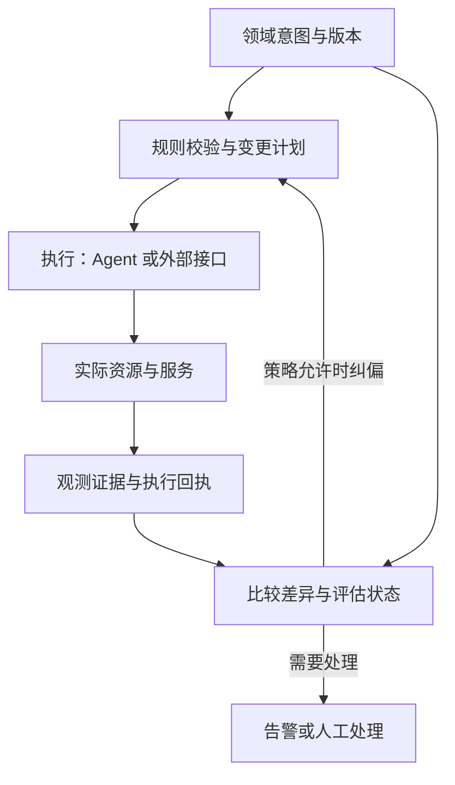

# 功能划分与逻辑结构

本文是 apsp 领域划分、代码结构、依赖与数据规则的依据（[ADR 0128](adr/0128-domain-architecture.md)，取代 [ADR 0125](adr/0125-feature-modules.md) 的功能模块与内核登记口；设备连接、备份与接入令牌的归属、接口地址和路由权限表按 [ADR 0132](adr/0132-platform-only-host-and-domain-addresses.md)）。逐项功能的归属见[领域归属表](domain-map.md)；对象与用语见[对象词典](redesign/03-objects.md)；界面分组（六个工作区）见[功能地图](product-map.md)，它与本文的领域分开组织：每个入口属于一个领域，一个工作区由几个领域的入口组成。

用户要求（2026-11-08）：APSP 重新设计成一个统一维护、按领域组织的一体化系统，功能分类从“管理什么对象、维护什么规则、对什么结果负责”出发；不再用插件的方式维护，全部自己维护，按技术本质重构代码、重写逻辑。

## 1. 当前结构

APSP 是按领域组织的模块化单体：一个面板、一个 Agent；九个领域维护自己的模型、数据和规则。面板不再有插件目录、插件注册层或业务插件开关。资源与设备接入、节点与链路、用户与套餐、客户端配置和用量账本构成主线，观测、作业、名称和费用支撑主线。

现行代码已完成平台与领域拆分、单一链路与来源模型、后台周期与咨询锁统一、供应商客户端统一，以及 ADR 0137 的跨领域列迁移。Nexus 仍服务的成员与已发布设备契约单独处理，不能从内部结构完成推导出生产兼容已退出。

## 2. 依据

### 2.1 分类的根据

从三件事推导结构：**对象身份、状态变化、必须始终成立的规则（不变量）**。

| 维度 | 回答的问题 | 例子 | 用途 |
| --- | --- | --- | --- |
| **领域归属** | 管理什么对象，谁保证规则正确？ | 服务授权、DNS 记录、主机路由 | **一级分类** |
| 技术职责 | 这段代码做什么技术工作？ | HTTP 接口、规则校验、SQL、协议转换 | 附加属性 |
| 运行位置 | 工作在哪里完成？ | 面板、Agent、云厂商接口 | 附加属性 |
| 交互入口 | 用户从哪里开始操作？ | 服务器详情、网络服务、用户门户 | 附加属性（工作区） |
| 维护状态 | 成熟到什么程度？ | 稳定、实验、冻结、迁移中 | 附加属性（元数据） |

用不变量检验边界：同一份用量上报不能重复扣减；一条链路不能引用不存在的端点；过期授权不能继续当作有效授权；一条 DNS 更新不能改到其他域名的记录。“这些功能看起来有关”不足以决定合并，要看它们是否共享规则、生命周期与变更责任。

### 2.2 理论

| 理论 | 要点 | 在 apsp 中意味着 |
| --- | --- | --- |
| 信息隐藏（Parnas 1972） | 按“可能变化的设计决定”分模块，每个模块藏一个秘密 | 阿里云接口的签名与分页由云接口实现负责；用量扣减与重置由服务权益负责；链路的表达与校验由流量服务负责；页面布局由界面层负责。四种知识变化的原因不同，维护边界也不同 |
| 一致性边界（Evans 2003；Vernon 2011） | 聚合围绕真实的不变量建立，关联对象多不等于要合成一个大模型 | 用户与凭据是一个聚合；链路与各段是一个聚合；外部来源与版本是一个聚合；彼此只经标识引用 |
| 内聚与耦合（Stevens、Myers、Constantine 1974） | 求功能内聚、数据耦合；最坏的是内容耦合（伸进别人内部） | 跨领域读写别人的私有表是内容耦合，由边界检查记账并逐步消除 |
| 包原则（Martin 2002） | 一起变化的放在一起（CCP），依赖无环（ADP），依赖指向稳定的一方（SDP） | 平台最稳定、只放机制；领域按依赖顺序排列；应用层最易变，负责组合 |
| 端口与适配器（Cockburn 2005） | 规则通过明确接口与外部技术交互 | 供应商接口、运行时与诊断工具是领域后面的实现，规则不依赖它们的细节 |
| 依赖倒置（Martin 1996） | 高层规则不依赖低层细节，双方依赖抽象 | 流量服务编译配置需要授权用户的凭据：由流量服务声明接口、服务权益实现、应用层接线，避免循环依赖 |
| 期望状态控制器（Kubernetes 控制器） | 围绕期望状态与当前状态协调 | 期望、执行、已应用与观测分别保存（第 6 节） |
| 康威定律、团队拓扑 | 结构复制协作结构；以认知负荷划边界 | 一位维护者加多个并行会话：单独读一个领域就能工作，领域有自己的说明与接口 |
| 适应度函数（Ford 等 2017） | 架构规则用自动检查守住，只许变好 | 边界检查按九个领域登记所有者，现有越界记账，新增越界失败 |
| 模块化单体 | 单一部署单元，内部强制模块边界 | 一个面板二进制、一个 Agent 二进制；九个领域各有自己的 crate，边界由依赖方向与边界检查守住 |

### 2.3 本项目已有的原则

划分必须延续项目自己写下的原则：面板保存期望状态并确定地编译完整快照，Agent 对账并回报，面板离线时节点照常运行（ADR 0001）；Agent 三层，core 只依赖 `adapter-sdk` 与 `protocol`，适配器是无状态翻译（ADR 0002）；流量只在一端计量一次（ADR 0004）；服务器网卡总流量与代理业务分开（ADR 0023）；功能准入与分级（ADR 0087、功能地图）；一个设置一处编辑，核心旅程不依赖实验页面（ADR 0098、0126）；当前结构单一基线，生产库以指纹证明接入（ADR 0122）。

## 3. 九个领域

### 3.1 七个对象与规则领域

| 领域 | 标识 | 核心问题 | 拥有的对象 | 关键不变量 |
| --- | --- | --- | --- | --- |
| 资源与设备 | `resources` | 管理哪些资源，它们是什么、处于什么生命周期？ | 服务器、云实例与 EIP 资源、硬件与系统资产、标签分组、资源来源、云账号关联、资源生命周期（接入、退役、替换）、接入令牌、设备连接（设备认证、设备会话与在线状态）、Agent 绑定与能力、云资源发现与启停 | 资源身份独立于 IP、Agent 安装与页面名称；替换必须显式 |
| 基础网络 | `networking` | 数据在基础设施中怎样到达目标？ | 网络接口、地址绑定、主机路由、解析器设置、NAT、端口转发、主机防火墙、云安全组、基础隧道、组网、网络调优 | 规则有明确作用域，保留各网络设施的实际语义 |
| 流量服务 | `traffic` | 提供什么连接服务，连接经过哪些端点？ | 服务实例（运行时）、协议与监听端点、受管节点、外部节点与外部来源、链路、分流与出口、配置编译、运行时能力、配置版本与部署状态 | 链路只引用存在的端点；同一输入编译出同一字节；sing-box 是实现之一 |
| 服务权益与交付 | `access` | 谁能用哪些服务、用多少，怎样取得配置？ | 服务用户、凭据、策略组、套餐与快照、额度与有效期、用量账本、周期重置、客户端配置与订阅地址、专属地址、门户、邀请、指南与提醒 | 用量不重复扣减；过期或用尽的权益不再交付；交付只包含有效权益覆盖的服务 |
| 名称与证书 | `naming` | 服务怎样被找到，端点怎样证明身份？ | 域名、DNS 账户、区域与记录、DDNS 规则、域名验证（DNS-01）、证书申请、上传、续期与版本、证书与端点的绑定 | 一次更新只改目标记录；DNS 生效、证书签发、服务加载与外部可达是四个不同事实 |
| 成本与费用 | `costs` | 花多少钱，按什么口径计费，何时续费？ | 续费项目与付费服务、付款记录、供应商计费流量与免费额度、云账单、币种汇率、预算、费用归属、Wallos 导入、续费日历与提醒 | 金额、口径、账期与来源清楚；预测与实际分开 |
| 平台治理 | `governance` | 谁可以管理 APSP，平台自身怎样保持可信、可恢复？ | 管理员、权限（含每条路由的权限结论）、会话、TOTP、Passkey、管理 API 令牌、凭据保管、审计、平台配置、面板与签名 Agent 发布目录（版本策略、发布签名 proof 与实体包校验存储，[ADR 0141](adr/0141-self-contained-agent-and-desired-service-config.md)）、平台自身的健康与记录保留策略；谁可以备份与恢复由这里的权限决定，备份的计划、执行与记录归作业，接入令牌归资源 | 只管 APSP 自身的身份、信任与生命周期；各业务设置归各自领域 |

### 3.2 两个运行支撑领域

| 领域 | 标识 | 拥有的对象 | 与其他领域的关系 |
| --- | --- | --- | --- |
| 观测证据与事件 | `observability` | 采集计划、遥测与测量结果、网卡流量计数、日志、诊断任务与报告、线路质量（延迟、可达性、IP 与 TCP 质量）、告警规则、告警事件与处置记录 | 记录事实与判断依据；被观测对象的配置与规则仍归其所属领域 |
| 变更与作业 | `operations` | 变更计划、作业、执行尝试、远程命令、终端会话、文件操作、批量任务、维护计划、定时与事件触发、自动化、执行结果、面板备份的计划、执行、恢复点与恢复演练记录、Agent 的自更新检查 | 把合法的操作可靠地执行出来；操作是否合法由对象所属领域判断 |

观测拥有“证据”，作业拥有“执行记录”。例如作业可以执行“修改用户额度”，但额度怎样计算、谁有资格修改、周期怎样处理，仍属于服务权益。领域自己的发布校验（运行时检查点、路径探测）属于该领域的已应用状态；通用测量属于观测。

### 3.3 平台与应用

| 层 | 标识 | 内容 | 不包含 |
| --- | --- | --- | --- |
| 平台 | `platform` | 数据库连接与基线核对、HTTP 外壳与中间件、内嵌前端、类型化接口的机制、向设备派发任务与接收观测证据的接口、各领域运行时状态的槽、后台任务的守护、周期执行与心跳、咨询锁的机制（锁键由各领域在自己的 `src/locks.rs` 声明）、设置存储、通知发送通道（渠道、模板与统一的投递器，各队列由所有者实现）、编译进来的发布信任根、令牌与内容摘要、文本检查、地址与名称的判断、对外请求与受控出站、X.509 证书读取、通用界面组件、供应商接口的技术实现（签名、分页、限流、重试） | 任何业务决定：什么时候续证书、什么时候发额度提醒、账单怎样换算、什么时候允许重启服务。设备连接归资源，凭据保管与签名 Agent 发布存储归治理，消息定义在 `protocol` |
| 应用 | `app` | 组合各领域：HTTP 路由、后台任务、跨领域流程的编排、联结几个所有者的组合视图（搜索、云页面总览）、依赖倒置接口的接线 | 领域规则本身 |

`common`、`shared`、`system` 这类目录只收明确的技术机制。一个模型被多处使用，先考虑由所有者公开稳定接口，而不是搬进公共目录。

## 4. 典型交叉的归属

**云厂商的能力分回实际领域。** ECS 实例的发现与启停、EIP 资源的申请与释放属于资源；EIP 与接口的连接关系、安全组规则属于基础网络；云 DNS 记录属于名称；CDT 计费流量与免费额度、账单属于成本；超额关机、定时开机、换 IP 工作流由作业编排；云接口的签名、分页、限流与错误处理是平台的技术实现。增加 Hetzner 支持即为相应领域补充供应商实现；供应商差异（安全组作用范围、实例状态、计费方式）保留，不为统一接口而丢失。

**sing-box 相关功能分成供给与使用。** 流量服务负责有哪些端点、用什么协议、流量经过哪些节点与链路、运行时支持哪些能力、配置怎样生成校验与应用、实际运行哪个版本；服务权益负责谁能用哪些服务、何时开始与结束、有多少额度、用量怎样记账、客户端得到什么配置、门户显示什么。客户端配置生成读取“有效权益”与“可交付服务描述”，不修改节点或部署状态。一个服务可以暂时没有用户，一个用户也可以暂时没有可用服务。

**DNS 按对象归属。** 公网域名的权威记录与 DDNS 属于名称；主机使用哪个解析器属于基础网络；代理服务怎样解析与分流 DNS 请求属于流量服务；检测解析是否正确属于观测。证书单独建模：DNS 更新完成不代表证书已签发，证书签发不代表服务已加载，服务加载不代表外部访问成功；每份受管证书有明确的控制者（面板签发、上传或运行时自行签发）与部署关系。

**三种“策略”分开。** 主机路由（IP 包走哪个接口与下一跳）属于基础网络；代理路由与出口选择属于流量服务；用户授权策略（能否使用这些资源）属于服务权益。TUN 等同时涉及前两者的功能，形成一个关联的变更计划，分别调用两个领域的合法操作。“组”只是组织方式：表示用户可访问哪些节点的策略组属于服务权益，表示自动选择出口与故障切换的分组属于流量服务。

**流量的三套口径。** 网卡收发计数（机器实际观察到的网络活动）属于观测；服务用户的用量与额度属于服务权益；云厂商计费流量与免费额度属于成本。三者在统计位置、方向、周期、经过链路的次数与精度上不同，各自保留原始口径，再建立解释与关联。

**管理员与服务用户分别建模。** 同一个人可以同时是两者，但授权分别计算：“允许使用节点”与“允许管理节点”始终是两个独立判断。密码、Passkey 等认证机制可以复用，主体类型、令牌用途与权限规则分开。

**恢复与升级按恢复对象划分。** 哪些面板与签名 Agent 发布可信、可用，谁可以备份与恢复，属于平台治理；云虚拟机快照属于资源；服务配置回滚属于流量服务，内置 `sing-box` 运行时随一体化 Agent 整包升级并在监督进程试用期内联动校验与回退（[ADR 0141](adr/0141-self-contained-agent-and-desired-service-config.md)）；执行部分都由作业完成：面板备份的计划、执行、恢复点与恢复演练记录，以及 Agent 的自更新检查都在作业（[ADR 0132](adr/0132-platform-only-host-and-domain-addresses.md)）。

## 5. 依赖与写入规则

### 5.1 依赖顺序

领域按下面的顺序排列，只依赖排在前面的领域（以及平台与 `protocol`）：

> 平台 → 平台治理 → 资源与设备 → 基础网络 → 名称与证书 → 流量服务 → 服务权益与交付 → 成本与费用、观测证据与事件 → 变更与作业 → 应用

平台内部也有顺序：`panel-host` 是底座，`cloud-api` 建在它上面（[ADR 0134](adr/0134-outbound-network-and-delivery.md)）。名称与证书排在基础网络之后：证书与域名的文档存放在基础网络的文档存储里，名称直接读它。成本与观测同组，互不依赖。

顺序反过来的需要用依赖倒置：排在前面的领域声明接口，排在后面的领域实现，应用层接线；同组的领域互不依赖，需要时由调用方声明接口。长期存在的有：资源的设备通道把设备回报交给拥有它们的领域（流量服务、服务权益与观测都排在资源之后）；前面的领域经平台的设备任务接口向设备派发任务，由作业执行；资源与成本经平台的观测证据接口记录服务器事件与故障，资源的服务器视图经自己声明的接口取得观测的数据；治理的审计记录需要被改动对象在变更前后的快照，由资源与流量服务回答——治理向后面的领域要的只有这一件，路由权限、审计脱敏键与签名工具的上游包都写在治理自己的表里，搜索与后台任务名在应用层；流量服务编译服务器配置需要用户的限速与连接数（服务权益实现）。现有接口的清单见 5.5。

### 5.2 写入与读取

1. **每张表只有一个所有者**，清单在 `tools/feature-boundaries.toml`；所有者以外的代码不写它。
2. **读取其他领域的数据经对方的公开接口。** 三张被普遍引用的身份表登记为“公开只读”：`servers`（资源）、`nodes`（流量服务）、`users`（服务权益）。依赖顺序中排在后面的领域可以直接读，但不写；排在前面的领域或平台需要它们时，经依赖倒置接口取得。平台的表（基线身份、凭据库、通知发件箱与渠道测试、设置存储、任务心跳）各领域经平台的接口使用，不直接读写。
3. **禁止**：直接写其他领域的表；引用其他领域的内部实现；绕过所有者的规则修改状态；循环依赖。
4. **跨领域流程放在应用层编排**，每一步调用所属领域的合法操作；异步、持久化或跨机器的步骤用平台的任务基础设施。
5. 外键只指向被引用对象所属领域的身份表；表名前缀暂不改（改名是数据库基线变更）。

### 5.3 自动守护

`tools/check-feature-boundaries.py` 按 `tools/feature-boundaries.toml` 检查四类越界：跨领域的 SQL（写其他所有者的表，读其他所有者的私有表或平台的表，逆着依赖顺序读公开只读表）、逆着依赖顺序的代码引用（从平台指向领域、从前面的领域指向后面的领域或同组的领域；同一 crate 内的 `crate::`、`super::` 路径，其他 crate 的路径如 `apsp_observability::incidents`，以及 crate 根再导出的其他 crate 的模块都算，代码搬到别的 crate 后越界跟着走）、跨 crate 的 `#[path]`、前端跨领域的引用（应用层的组合页面可以引用各领域）。清单里的依赖顺序与公开只读表就是 5.1、5.2 的规则；每个所有者有自己的 crate，清单的代码部分一个 crate 一行（配置编译库 `crates/compiler` 归流量服务）。现有越界记在 `tools/feature-boundaries.baseline`，只许减少，新增越界直接失败，新增表或新的所有者名没有登记也失败。

`tools/check-core-boundary.py` 检查 Agent core 与平台 crate（`panel-host`、`cloud-api`）不出现代理业务词汇，并按层级检查每个 crate 的工作区依赖：平台只依赖 `protocol`；领域 crate（`crates/governance` 是第一个）只依赖平台、`protocol`、依赖顺序中排在前面的领域 crate 与同一领域的其他 crate；新增的 crate 没有登记层级就失败。禁用词的例外按表达式逐条列出，`panel-host` 只剩 `src/config.rs` 里的一条。

路由权限由一张审阅过的结论表守住（[ADR 0132](adr/0132-platform-only-host-and-domain-addresses.md)）。权限规则只写在治理的请求守卫里（`crates/governance/src/control_center/guard.rs`），`guard::describe` 给出守卫对一个“路由、方法”的结论：谁可以调用、服务器范围、是否要求近期的再次验证。`crates/panel/tests/fixtures/route-policy.tsv` 一行记一条结论，两项检查分别守住它的两面：

- Rust 测试 `crates/panel/tests/route_policy.rs` 对表里每一行重新求结论，与记录不同就失败，所以改动任何一条权限规则都会显示为逐条路由的差异；没有登记的管理地址只有所有者会话能通过。
- `python3 tools/route-policy.py` 比对表里的路由清单与源码里登记的路由，缺行或多出行就失败。它按文本读取 `.route("完整路径", …)`，所以路由的完整路径必须写在声明处，不用前缀嵌套。

新增或改动路由后，先 `python3 tools/route-policy.py --write`（新路由的结论先记为 `?`，已删除的路由去掉），再 `APSP_BLESS_ROUTE_POLICY=1 cargo test -p apsp-panel --test route_policy` 填入结论，审阅表的差异后提交。

### 5.4 代码结构

每个领域的代码在自己的 crate 与前端目录里，平台不含领域代码，应用层只做组合。

| 部分 | 现在 | 目标 |
| --- | --- | --- |
| 平台 | `crates/panel-host` 只有技术机制：HTTP 外壳与内嵌前端（`shell`、`frontend`）、配置（`config`）、基线核对（`schema`）、共享状态与各领域运行时状态的槽（`state` 的 `AppState`、`DomainStates`）、类型化接口的机制（`ports`）、设备任务接口（`device_work`）、观测证据接口（`evidence`）、后台任务的守护、周期执行器与心跳（`maintenance`，ADR 0133）、咨询锁（`locks`，ADR 0133）、设置存储（`settings`：读取、锁定、共享与保存）、口令散列（`passwords`）、金额（`money`）、日期（`time`）、Cookie（`cookies`）、通知的渠道、模板与统一的投递器（`notifications`，各队列由所有者实现，告警发件箱归观测）、对外请求（`http`：出站客户端、有界读取、状态码与 `Retry-After`）、令牌、文本与摘要检查（`tokens`、`text`、`digest`）、地址与名称的判断、受控出站与拨号（`net`）、X.509 读取（`x509`）、错误类型（`error`）。`AppState` 只有连接池、启动时间、配置、三个进程级的并发许可、编译进来的发布信任根与 `domain_states`。`crates/cloud-api` 建在 `panel-host` 之上，是供应商接口的签名与客户端 | 不变（告警发件箱已迁到观测，平台不再读任何领域的表） |
| 领域 | 每个领域一个 crate：`crates/governance`、`crates/resources`、`crates/networking`、`crates/naming`、`crates/traffic`（配置编译库是同一领域的 `crates/compiler`）、`crates/access`、`crates/costs`、`crates/observability`、`crates/operations`。crate 内按对象分模块；每个 crate 只导出一个 `routes()`，路由的完整路径写在声明处。成本、观测与作业 crate 的 `cloud` 模块是云能力，诊断工具在观测的 `diagnostic_tools/` | 不变；对象的模型、规则、存储与接口放在同一模块，参考过的上游代码放在该 crate 的 `upstream/`（第 10 节） |
| 应用 | `crates/panel`：`domains.rs` 是唯一的组合处，有一张路由清单（按依赖顺序合并各领域的 `routes()`，加上云页面总览（云页面与作业页的两个视图）、搜索、系统健康与服务器导出四个跨领域视图）与一张后台任务清单（逐个守护，并声明健康视图应当看到的心跳名）；`wiring.rs` 接线全部类型化接口；`search.rs`（全局搜索）、`cloud_overview.rs`（云页面总览）与 `system_health.rs`（系统健康：治理的面板状态加作业、观测各自给出的积压摘要）是联结几个所有者的组合视图；`moved_paths.rs` 在普通 `/api/plugins/*` 控制台过渡改写期满移除后，仅精确改写外部续费日历订阅契约 `/api/plugins/expenses/calendar.ics` → `/api/costs/calendar.ics`（已发外部代理用户链接 `#/plugins/sing-box/{account,member,join}` 在 `web/src/app/routes.ts` 永久规范化为 `#/{account,member,join}`，`/sub/{token}` 与个人专属地址留在 `access`）；`publisher.rs` 是跨流量服务与服务权益的代理发布周期；`maintenance.rs` 是 30 秒维护循环；`lib.rs` 给平台外壳套上治理的权限守卫与专属地址网关；`main.rs` 只建立状态、路由与后台任务。唯一的数据库基线也在这个 crate | 不变；外部日历订阅与已发用户地址作为长期契约保留 |
| 前端 | 按领域分目录：`web/src/<领域标识>/` 放该领域的页面、模型与接口调用，每个领域在自己的 `pages.tsx` 声明页面；应用层的 `app/` 放外框与组合页面（服务器详情、概览），并把各领域的清单汇总成路由与侧栏；平台的 `components/`、`lib/`、`stores/` 和根目录的通用文件是通用界面层 | 不变 |

跨领域共用的数据模型不进公共目录：由所有者公开类型与函数，其他领域引用所有者的公开部分。

### 5.5 类型化接口

领域之间需要逆着依赖顺序调用时，由调用方声明一个类型化接口，实现方回答，应用层的 `crates/panel/src/wiring.rs` 在启动时接线（平台的 `ports` 只提供“安装一次、按需读取”的机制）。接口的数据类型属于声明方；实现方排在后面时返回自己的类型，由应用层转换。几个排在前面的领域都要调用同一个后面的所有者、而这件事本身是平台的基础设施时（向设备派发任务、记录观测证据），接口由平台声明，不在每个调用方各声明一份。

现在一共十五个接口，每个只装一件事；不再有把几件不相干的事装在一起、由各领域登记的钩子（[ADR 0132](adr/0132-platform-only-host-and-domain-addresses.md) 拆掉了治理的 `Contributions`，名称迁入自己的 crate 后 `Dns01` 也已删除）。

| 接口 | 声明方 | 实现方 | 内容 | 性质 |
| --- | --- | --- | --- | --- |
| `device_channel::DeviceReports` | 资源（设备通道） | 资源、流量服务、服务权益、观测（应用层分派） | 设备的问候、心跳、静态信息、指标、应用结果、检查点与路径探测回执、诊断取消、用量批次、会话报告、退役回执 | 长期：设备通道在资源，回报的所有者多数排在资源之后 |
| `device_work::DeviceWork` | 平台（向设备派发任务的入口） | 作业（`crates/operations`） | 设备此刻能否接收新任务（资源生命周期、维护窗口、互斥作业与结果未知的操作）、提交固定设备操作与预检用的只读观察（含设备是否关闭 `closed_tx`、已提交操作的状态 `operation_tx`）；网络配置、证书部署、诊断与 sing-box 的按需部署预检经它派发与判断 | 长期：作业排在最后，前面的领域只能经平台向设备派发任务 |
| `evidence::Evidence` | 平台（观测证据的接收口） | 观测（`crates/observability`） | 服务器时间线上的事件、故障的打开与恢复，以及计划退订提醒的单次故障事件获取（`ensure_incident_once_tx`，已 `resolved` 不重开）与待发通知取消（`cancel_pending_incident_notifications_tx`）；资源（生命周期、接入、费用记录、云资源）、成本（计划退订，不再直读或更新观测表）与作业（面板备份）经它报告 | 长期：观测排在资源之后，与成本同组 |
| `guard::AuditSnapshots` | 治理（请求守卫的审计） | 资源（`servers::audit_snapshot`）、流量服务（`nodes::audit_snapshot`） | 审计记录里被改动对象在变更前后的快照；地址后面没有所有者保存的对象时答“无” | 长期：治理排在最前 |
| `server_observation::ServerObservation` | 资源 | 观测 | 服务器视图的流量摘要与实时遥测、存储的指标与遥测设置（视图、采集迁移与档案读写；成员线路与流量服务的运行视图也经它读指标）、接入模板预览的拨测与告警规则校验，以及单台新增与模板批量接入在同一事务内的监测初始化 `initialize_tx`（规范化并保存遥测设置、为每台服务器生成新拨测与模板告警 UUID、分配默认延迟检测任务） | 长期：资源排在观测之前；视图的流量摘要类型属于资源 |
| `server_runtime::ServerRuntime` | 资源 | 流量服务 | 服务器视图与档案里的发布修订号（`manifest_rev`）、采集迁移预览里该服务器启用的运行时与部署状态 | 长期：资源排在流量服务之前；发布状态归流量服务（`runtime_publications`） |
| `cloud::work::CloudWork` | 资源（云账号与云资源） | 作业（`crates/operations` 的 `cloud`） | 资源上有没有进行中或结果未知的操作、地址是否在换 IP 中、配置变化后取消预览与排队中的操作；安全组变更前也经它确认资源空闲 | 长期：作业排在最后 |
| `cloud::automation::CloudAutomation` | 资源（云账号与云资源） | 作业（`crates/operations` 的 `cloud/automation.rs`） | 账号与资源表单里的自动化设置（自动带宽的开关与额度、电源策略、带宽上限、暂停）在同一事务里交给作业；账号的新建、编辑、归档与刷新，资源的新建、编辑与归档；关闭账单查询前看账单是否仍被自动化使用 | 长期：资源排在作业之前；自动化状态归作业（`cloud_account_automation`、`cloud_resource_automation`） |
| `cloud::billing::CloudBilling` | 资源（云账号与云资源） | 成本 | 云账号的计费开关与账单状态（读），账号的新建、编辑、归档与刷新结果交给成本（同一事务）；编辑时作废旧配置下的账单、余额与 CDT 读数 | 长期：资源排在成本之前；成本的状态归成本（`cloud_account_billing`、`cloud_resource_billing`） |
| `cloud_resources::costs::ResourceCosts` | 资源（云资源与服务器的关联） | 成本 | 关联表单里的月预算与未关联服务器时的采购记录（与关联同一事务写入），云资源列表里成本的那部分 | 长期：资源排在成本之前；云资源的采购与预算归成本（`cloud_resource_costs`） |
| `users::Users`（流量服务） | 流量服务 | 服务权益（`crates/access`） | 编译进配置的用户限速与连接数；节点删除或接管后用户凭据与策略组成员的变化；Nexus 主机的设备数限制与兼容桥同步状态；代理运维记录 | 长期：服务权益排在流量服务之后 |
| `china_reachability::ChinaReachability`（流量服务） | 流量服务（Nexus 切换） | 观测 | 节点最近是否测得国内不可达 | 长期：观测排在流量服务之后 |
| `HostNetwork`（服务权益的门户） | 服务权益（成员线路目录） | 观测 | 成员可见的主机网络属性（只含网络身份、用途、风险标记与评分）及一小时窗口的脱敏三网拨测延迟摘要 `carrier_latencies`（按服务器批量读取最新、均值与丢包，不暴露 IP、主机名、城市或坐标） | 长期：观测排在服务权益之后 |
| `dashboard::ExchangeRates`（观测的看板） | 观测 | 成本（`crates/costs`） | 看板折算成本用的当前汇率 | 长期：成本与观测同组，互不依赖 |
| `notifications::outbox::Outbox` | 平台（通知设置与渠道页） | 观测（告警发件箱 `alerts::outbox`） | 设置或渠道变更时取消过时的待发消息、渠道页的投递统计 | 长期：发件箱是观测的告警投递队列，平台不读领域的表 |

## 6. 运行模型：期望、执行、已应用、观测分别保存

这张图描述运行关系，不是另一套模块分类。每类受管对象明确四种信息：

| 信息 | 含义 | 示例 |
| --- | --- | --- |
| 期望状态 | 用户与领域规则要求什么 | 服务应运行配置第 18 版 |
| 执行状态 | 现在正在做什么 | 已创建部署任务，第二次尝试中 |
| 已应用状态 | 目标确认应用了什么 | Agent 回执确认应用第 17 版 |
| 观测事实 | 最近实际测到什么 | 30 秒前端口可达，进程仍报告第 17 版 |

必须守住的规则：证据带时间、来源与版本，过期的观测不当作当前事实；执行结果绑定目标代次，旧 Agent 的迟到回执不能覆盖新安装实例的状态；网络超时意味着结果未知，对外部操作不一律当作失败并立即重试；自动重试要求操作本身可以安全重放；授权变更与实际执行生效分别记录。界面用语见[状态设计](redesign/06-states.md)。

## 7. 基础模型

- **资源身份与 Agent 身份分开**：`ResourceId` 是受管资源的稳定身份，`AgentId` 是执行程序的机器身份，另有每次安装的绑定代次。由此能表达：服务器存在但尚未安装 Agent；Agent 离线而云实例仍在运行并计费；重装 Agent 后资产记录仍然有效；更换 IP 后服务与费用的关联仍在。云实例重建是否继承原资源身份，通过显式的替换操作决定，不凭相同 IP 或名称自动合并。
- **服务实例、端点、链路分别建模**：服务实例是某个资源上运行的受管服务；服务端点是客户端或其他服务能连接的入口与出口；链路是端点之间有顺序与约束的连接；外部来源是外部节点描述的输入；配置版本由确定输入编译出、可追溯。自建端点可以部署、修改与重启，外部端点只能引用、检查与随来源更新，模型中表达这些能力差异。
- **“订阅”拆成准确名称**：外部来源（从外部获取节点）、客户端订阅（给用户客户端的配置）、付费服务（自己周期付费的服务）、续费日历（给日历程序的提醒输出）各有模型。
- **一个事实一个所有者**：服务器详情组合资源信息（资源）、网络规则（基础网络）、服务运行状态（流量服务）、费用与到期（成本）、最近诊断（观测），但不另存一套费用、规则或健康算法。

## 8. 用真实流程检验边界

| 流程 | 依次经过的领域与各自的责任 |
| --- | --- |
| 新服务器接入并运行服务 | 治理判断谁可以接入机器并提供可选签名 Agent 版本 → 资源签发接入令牌、登记资源与 Agent 绑定并建立设备连接 → 流量服务创建启用端点并自动编译下发期望配置（一体化 Agent 自动提取并拉起内置运行时）→ 观测记录健康与可达 → 服务权益把端点纳入策略组 |
| 为用户授权并交付客户端配置 | 服务权益创建用户、套餐快照与策略组成员关系 → 流量服务（经依赖倒置接口）把凭据编入相关服务器的配置并下发 → 服务权益生成客户端订阅 → 观测记录订阅拉取 |
| 服务器地址变化 | 资源记录新的地址事实 → 名称更新指向它的记录（DDNS）→ 流量服务按端点引用重新编译受影响的配置 → 观测确认解析与连通 |
| 诊断发现故障并触发受约束的修复 | 观测产生告警与证据 → 作业按自动化规则提出修复计划 → 所属领域（如流量服务）判断操作是否允许 → 作业执行并记录 → 观测确认恢复 |
| 云计费额度接近阈值 | 成本按供应商口径算出额度状态 → 作业按规则提出关机请求 → 资源判断目标机器当前是否允许关机 → 作业执行并记录 → 观测确认后续状态 |
| 升级失败后回退，或从平台备份恢复 | 治理判断签名 Agent 发布可信与协议兼容、谁可以恢复 → 作业按恢复点或自更新规则推进升级、回退或备份恢复（Agent 试用失败时与内置运行时一并回退）→ 流量服务确认目标配置已应用 → 观测确认 |

流程中若出现“某个领域必须直接修改另一个领域的内部数据”，就说明接口或归属划错了。

## 9. 整合状态

| 对象或机制 | 当前归属与实现 |
| --- | --- |
| 平台外壳与供应商客户端 | `panel-host`、`cloud-api`；供应商接口各一份 |
| 节点、链路与外部来源 | `traffic` 与配置编译库 `compiler`；链路与来源各一套模型 |
| 用户、授权、订阅与计量 | `access`；代理用量统计账本查询位于 `crates/access/src/usage/statistics.rs`（观测入口只做鉴权、窗口校验与呈现组合）；迁移采用时保留凭据、旧地址与用量 |
| 云资源、网络、计费与自动作业 | 分别归 `resources`、`networking`、`costs`、`operations` |
| 诊断实现与证据 | `observability/diagnostic_tools`；Agent 固定适配器执行；控制台报告视图将存储键投影为 `ReportRecord.job.tool` |
| 一体化 Agent、内置组件与服务定义 | `crates/agent/`、`deploy/`、`tools/singbox-runtime/`、`crates/observability/upstream/` 与 `tools/network_workbench_artifact.py`；Linux 正式构建强制内嵌 `sing-box`、`-r22` `nodequality`、`ipquality`、`network-workbench` 四组件闭环及原生 `tcp-probe`，Agent 整包独立验签（ADR 0141） |
| 生命周期与共同机制 | 所有者的类型化函数（如 `server_lifecycle::policy`、`traffic::nexus_nodes`、`ServerObservation::initialize_tx`、`HostNetwork::carrier_latencies`、`Evidence` 单次故障与通知取消）、平台周期器、锁、受控出站与投递器 |

ADR 0137 的会话、观测、流量发布、成本、作业与资产列迁移已经完成，不再按旧阶段清单重复排期。面板已按 ADR 0141 移除独立制品库、手工运行时启用与阻塞普通节点发布的人工预检确认流；诊断按工具命名（`tool`、`tools`、`tool_ready`、`tool_reason`），公开资源端点使用 `runtime_enabled`，服务器运行时状态以 `configured` 与 `status`（`unconfigured`、`waiting_agent`、`upgrade_required`、`offline`、`pending`、`ready`、`sync_blocked`、`failed` 及 `current_healthy`）表达；已发布 Agent wire JSON、数据库任务记录、持久化检查点、签名材料和设备磁盘路径（`/opt/apsp/plugins/...`、`/var/lib/apsp/plugins/...`）是外部契约，精确的序列化名称（`plugin`）不构成插件架构，见 ADR 0140 与 ADR 0141。

## 10. 上游代码：每个领域自己维护

参考过的上游代码，凡是功能依赖的，都在所属领域的 `upstream/` 里保留一份可离线构建的来源：固定版本的源码或文件、许可、`UPSTREAM.md`（拿了什么、改了什么、怎么跟进）。构建只用仓库里的副本，制品附带上游许可与说明。

| 上游 | 归属 | 现在 | 目标 |
| --- | --- | --- | --- |
| sing-box（SagerNet） | 流量服务 | 构建时克隆 v1.14.4，打补丁（`tools/singbox-runtime/`）并内嵌进 `apsp-agent` | 补丁队列与配方移入流量服务的 `upstream/sing-box/`，记录每个补丁的目的；内嵌归档附带许可 |
| NodeQuality、HardwareQuality、IPQuality、NetQuality（AGPL-3.0） | 观测 | 打包脚本、策略与锁定文件在 `crates/observability/upstream/`，生成离线包供 Linux 正式 `apsp-agent` 编译期内嵌（设备落盘与历史签名格式在边界仍按原名 `plugins/...` 记录） | 固定版本的脚本连同许可放进观测的 `upstream/`，策略改写变成提交过的补丁，离线构建 |
| TcpQuality | 观测 | 只借用命令约定，自写 `crates/tcp-probe` 并内置为 `apsp-agent tcp-probe` 子命令 | 不变；`UPSTREAM.md` 记录来源与无许可的原因 |
| Nexus：Xboard、xboard-node | 流量服务与服务权益的兼容模块 | 兼容桥在旧面板里执行 PHP；尚未原生采用的迁移成员订阅仍由旧面板渲染 | 不维护分支；完成成员原生采用、公开入口切换与兼容桥退出后删除兼容模块（见[路线图](roadmap.md)与[成员原生采用](native-adoption.md)） |
| lego（go-acme） | 名称与证书 | 期待签名制品，仓库里没有构建配方 | 补固定版本的配方，或随网络配置一起冻结（待定） |
| CDT-Monitor、原 CDT 与换 IP 脚本 | 成本与作业 | 参考思路，自己实现 | 不变；`UPSTREAM.md` 记录 |
| IPFlare、ddns-go | 名称与证书 | 参考思路，自己实现 | 不变；`UPSTREAM.md` 记录 |
| Wallos | 成本与费用 | 导入其数据（`tools/export_wallos.py`） | 不变；导入脚本移入成本领域 |
| NodeFlare（MIT） | 观测（看板）与界面 | 借用看板布局与系统图标 | 恢复许可说明的链接 |
| 妙妙屋、3X-UI/S-UI、Sub-Store/mihomo | 流量服务与服务权益 | 参考格式与表单，自己实现 | 不变；`UPSTREAM.md` 记录 |
| shadcn/ui | 平台的界面组件 | 组件源码已复制进仓库 | 不变 |

外部服务（check.place、AbuseIPDB、Globalping、Frankfurter、Telegram 等）不是上游源码。Cloudflare 与 Globalping 的客户端已各合为 `cloud-api` 中一份（ADR 0135）；业务规则仍由各领域维护。

## 11. 当前边界与待验条件

- **源码原生架构与生产发布/切换分层记录：** 工作树已完成九领域收口、一体化自带能力 Agent（`agent:self-contained:v1`，ADR 0141）及先预览后原子提交的成员原生采用实现；但包含 Linux 四组件内嵌闭环的新版一体化 Agent **尚未构建签署正式 GitHub Release 并完成实机升级验收**（最新已发布标签仍为 ADR 0141 之前的 `agent-v0.3.9`），生产上的 Nexus 成员采用、公开原订阅入口反代切换与兼容桥退役也**尚未执行**，CI 工作流仍按协作规则暂停。采用必须同时核对原 UUID、既发订阅地址、当期已用量、额度抵扣、暂停与重新发布；桥退出后再删除只为桥服务的历史身份与旧渲染依赖。
- 已发布 Agent 的协议字段、数据库任务记录、持久化检查点、设备路径和已签发布格式按原契约读取；内部使用 `tool`、`runtime_enabled`、`configured`，控制台诊断报告响应在呈现边界投影为 `ReportRecord.job.tool`，不新增旧名接口包装。
- NodeQuality 完整执行门禁与网络检测实机签收门禁继续有效；历史验收只证明对应提交，不能认证当前组合。
- ACME 的 lego 仍需固定可构建来源；名称功能转正时将文档存储从基础网络迁回名称领域。

## 12. 当前优化项

本轮已完成代理用量统计迁入 `crates/access/src/usage/statistics.rs`、`operations -> resources` 生命周期策略归入 `server_lifecycle::policy`、`access -> traffic` 迁移运行时节点与主机查询归入 `traffic::nexus_nodes`、新服务器与批量模板监测初始化归入 `ServerObservation::initialize_tx`、门户三网拨测延迟摘要归入 `HostNetwork::carrier_latencies`、退订提醒事件与通知取消归入 `Evidence`；对应跨界条目已从 `tools/feature-boundaries.baseline` 移除。以下既有遗留越界仍登记在 `tools/feature-boundaries.baseline` 中（非零基线，严格单调递减、零新增豁免）：

| 事项 | 当前保留的基线项与处理原则 |
| --- | --- |
| 供应商对照读取诊断表 | `crates/costs/src/suppliers.rs` 仍只读查询 `diagnostic_jobs` 与 `diagnostic_report_sections`（冻结功能）；后续若转正或调整，经观测所有者摘要接口读取 |
| 流量服务与服务权益剩余互读 | 除已收口的 `nexus_nodes` 查询与 `singbox_legacy_served_users()` 外，剩余跨表读取继续按所有者查询函数或 `users::Users` 逐步收敛，保持事务与锁顺序 |
| 名称与基础网络文档表 | `crates/naming/src/acme.rs` 仍读取 `network_documents`；随证书文档存储归属收口一并消除 |
| 凭据库表归属 | `credential_entries` 登记在平台而加密读写在治理，多处只读存在性检查记在基线；决定唯一所有者后同步全部调用 |
| 前端跨领域引用 | 已消除共享组件与云费用图表的反向引用；剩余条目通过应用层组合或平台通用机制逐步收敛，不为减少计数制造公共业务类型库 |
| 新版一体化 Agent 发布与生产采用 | 按正式发布流程构建签署内嵌闭环的新版 `apsp-agent` Release，再分批升级在线设备并推进 Nexus 成员原生采用；配置下发按各服务器自身在线能力独立判断，不因其他主机未升级而受阻 |
| 外部订阅与权益查询性能 | 以真实调用和生产规模数据对比，不仅凭 SQL 写法判断 |

`tools/feature-boundaries.baseline` 是当前遗留越界的真实逐项台账，只许减少，不宣称基线已清零或已通过全领域实机验收。统一的通知投递器已经完成，六张业务队列表、预览存储和不同所有者的事件日志按各自语义保留，不为形式统一而合表。
