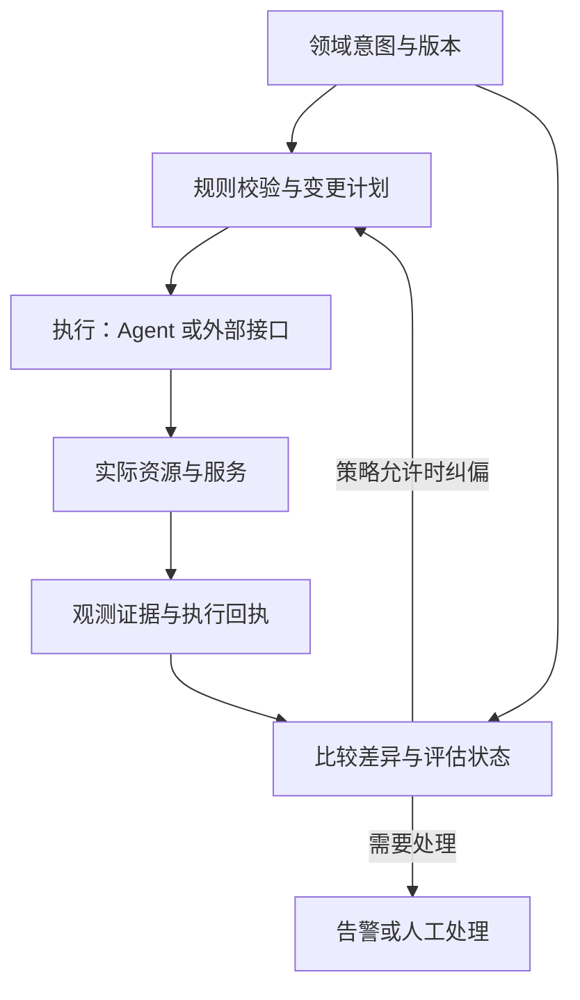

# 功能划分与逻辑结构

本文是 apsp 领域划分、代码结构、依赖与数据规则的依据（[ADR 0128](adr/0128-domain-architecture.md)，取代 [ADR 0125](adr/0125-feature-modules.md) 的功能模块与内核登记口；设备连接、备份与接入令牌的归属、接口地址和路由权限表按 [ADR 0132](adr/0132-platform-only-host-and-domain-addresses.md)）。逐项功能的归属见[领域归属表](domain-map.md)；对象与用语见[对象词典](redesign/03-objects.md)；界面分组（六个工作区）见[功能地图](product-map.md)，它与本文的领域分开组织：每个入口属于一个领域，一个工作区由几个领域的入口组成。

用户要求（2026-11-08）：APSP 重新设计成一个统一维护、按领域组织的一体化系统，功能分类从“管理什么对象、维护什么规则、对什么结果负责”出发；不再用插件的方式维护，全部自己维护，按技术本质重构代码、重写逻辑。

## 1. 现状：哪里没有划分好

2026-11-07 对 main（d24bd135）的只读调查（原 ADR 0125 的调查，结论仍然成立）：

- **插件边界不是业务边界。** sing-box 插件约 4.5 万行，装着节点、三套链路模型、两套来源模型、代理用户与授权、订阅输出、门户与邀请、运行时部署和 Nexus 迁移工具，服务的“供给”和“使用”混在一起；阿里云插件同时管云资源、启停作业、安全组、CDT 计费流量与换 IP 工作流；宿主约 4.2 万行，除平台机制外还装着自动化与维护、网络检测、网络配置、IP 质量、管理与安全、备份、服务器资产与费用、统计等十来个领域。
- **“插件之间不能依赖”造成重复。** 两个 Globalping 客户端、专属地址自带的 Cloudflare 客户端、每个插件各自的通知发件箱，都是因为插件不能调用另一个插件。
- **接口过宽，登记靠手写。** `PanelPlugins` 一个 trait 有 22 个方法，在组装 crate 里手工把每个钩子映射到某个插件；路由权限按路径前缀字符串写在组装层。
- **数据没有归属。** 一份 6,674 行的基线装着全部 253 张表与视图，跨领域读写普遍；九张旧商务表已无代码引用。
- **前端没有领域模块。** 加一个页面要改 5 个文件；概览首页在 sing-box 目录里；有两套界面组件。

## 2. 依据

### 2.1 分类的根据

从三件事推导结构：**对象身份、状态变化、必须始终成立的规则（不变量）**。

| 维度 | 回答的问题 | 例子 | 用途 |
| --- | --- | --- | --- |
| **领域归属** | 管理什么对象，谁保证规则正确？ | 服务授权、DNS 记录、主机路由 | **一级分类** |
| 技术职责 | 这段代码做什么技术工作？ | HTTP 接口、规则校验、SQL、协议转换 | 附加属性 |
| 运行位置 | 工作在哪里完成？ | 面板、Agent、云厂商接口 | 附加属性 |
| 交互入口 | 用户从哪里开始操作？ | 服务器详情、网络服务、用户门户 | 附加属性（工作区） |
| 维护状态 | 成熟到什么程度？ | 稳定、实验、冻结、迁移中 | 附加属性（元数据） |

用不变量检验边界：同一份用量上报不能重复扣减；一条链路不能引用不存在的端点；过期授权不能继续当作有效授权；一条 DNS 更新不能改到其他域名的记录。“这些功能看起来有关”不足以决定合并，要看它们是否共享规则、生命周期与变更责任。

### 2.2 理论

| 理论 | 要点 | 在 apsp 中意味着 |
| --- | --- | --- |
| 信息隐藏（Parnas 1972） | 按“可能变化的设计决定”分模块，每个模块藏一个秘密 | 阿里云接口的签名与分页由云接口实现负责；用量扣减与重置由服务权益负责；链路的表达与校验由流量服务负责；页面布局由界面层负责。四种知识变化的原因不同，维护边界也不同 |
| 一致性边界（Evans 2003；Vernon 2011） | 聚合围绕真实的不变量建立，关联对象多不等于要合成一个大模型 | 用户与凭据是一个聚合；链路与各段是一个聚合；外部来源与版本是一个聚合；彼此只经标识引用 |
| 内聚与耦合（Stevens、Myers、Constantine 1974） | 求功能内聚、数据耦合；最坏的是内容耦合（伸进别人内部） | 跨领域读写别人的私有表是内容耦合，由边界检查记账并逐步消除 |
| 包原则（Martin 2002） | 一起变化的放在一起（CCP），依赖无环（ADP），依赖指向稳定的一方（SDP） | 平台最稳定、只放机制；领域按依赖顺序排列；应用层最易变，负责组合 |
| 端口与适配器（Cockburn 2005） | 规则通过明确接口与外部技术交互 | 供应商接口、运行时与诊断工具是领域后面的实现，规则不依赖它们的细节 |
| 依赖倒置（Martin 1996） | 高层规则不依赖低层细节，双方依赖抽象 | 流量服务编译配置需要授权用户的凭据：由流量服务声明接口、服务权益实现、应用层接线，避免循环依赖 |
| 期望状态控制器（Kubernetes 控制器） | 围绕期望状态与当前状态协调 | 期望、执行、已应用与观测分别保存（第 6 节） |
| 康威定律、团队拓扑 | 结构复制协作结构；以认知负荷划边界 | 一位维护者加多个并行会话：单独读一个领域就能工作，领域有自己的说明与接口 |
| 适应度函数（Ford 等 2017） | 架构规则用自动检查守住，只许变好 | 边界检查按九个领域登记所有者，现有越界记账，新增越界失败 |
| 模块化单体 | 单一部署单元，内部强制模块边界 | 一个面板二进制、一个 Agent 二进制；九个领域各有自己的 crate，边界由依赖方向与边界检查守住 |

### 2.3 本项目已有的原则

划分必须延续项目自己写下的原则：面板保存期望状态并确定地编译完整快照，Agent 对账并回报，面板离线时节点照常运行（ADR 0001）；Agent 三层，core 只依赖 `adapter-sdk` 与 `protocol`，适配器是无状态翻译（ADR 0002）；流量只在一端计量一次（ADR 0004）；服务器网卡总流量与代理业务分开（ADR 0023）；功能准入与分级（ADR 0087、功能地图）；一个设置一处编辑，核心旅程不依赖实验页面（ADR 0098、0126）；当前结构单一基线，生产库以指纹证明接入（ADR 0122）。

## 3. 九个领域

### 3.1 七个对象与规则领域

| 领域 | 标识 | 核心问题 | 拥有的对象 | 关键不变量 |
| --- | --- | --- | --- | --- |
| 资源与设备 | `resources` | 管理哪些资源，它们是什么、处于什么生命周期？ | 服务器、云实例与 EIP 资源、硬件与系统资产、标签分组、资源来源、云账号关联、资源生命周期（接入、退役、替换）、接入令牌、设备连接（设备认证、设备会话与在线状态）、Agent 绑定与能力、云资源发现与启停 | 资源身份独立于 IP、Agent 安装与页面名称；替换必须显式 |
| 基础网络 | `networking` | 数据在基础设施中怎样到达目标？ | 网络接口、地址绑定、主机路由、解析器设置、NAT、端口转发、主机防火墙、云安全组、基础隧道、组网、网络调优 | 规则有明确作用域，保留各网络设施的实际语义 |
| 流量服务 | `traffic` | 提供什么连接服务，连接经过哪些端点？ | 服务实例（运行时）、协议与监听端点、受管节点、外部节点与外部来源、链路、分流与出口、配置编译、运行时能力、配置版本与部署状态 | 链路只引用存在的端点；同一输入编译出同一字节；sing-box 是实现之一 |
| 服务权益与交付 | `access` | 谁能用哪些服务、用多少，怎样取得配置？ | 服务用户、凭据、策略组、套餐与快照、额度与有效期、用量账本、周期重置、客户端配置与订阅地址、专属地址、门户、邀请、指南与提醒 | 用量不重复扣减；过期或用尽的权益不再交付；交付只包含有效权益覆盖的服务 |
| 名称与证书 | `naming` | 服务怎样被找到，端点怎样证明身份？ | 域名、DNS 账户、区域与记录、DDNS 规则、域名验证（DNS-01）、证书申请、上传、续期与版本、证书与端点的绑定 | 一次更新只改目标记录；DNS 生效、证书签发、服务加载与外部可达是四个不同事实 |
| 成本与费用 | `costs` | 花多少钱，按什么口径计费，何时续费？ | 续费项目与付费服务、付款记录、供应商计费流量与免费额度、云账单、币种汇率、预算、费用归属、Wallos 导入、续费日历与提醒 | 金额、口径、账期与来源清楚；预测与实际分开 |
| 平台治理 | `governance` | 谁可以管理 APSP，平台自身怎样保持可信、可恢复？ | 管理员、权限（含每条路由的权限结论）、会话、TOTP、Passkey、管理 API 令牌、凭据保管、审计、平台配置、面板与 Agent 的版本与制品（策略与签名制品的存储）、平台自身的健康与记录保留策略；谁可以备份与恢复由这里的权限决定，备份的计划、执行与记录归作业，接入令牌归资源 | 只管 APSP 自身的身份、信任与生命周期；各业务设置归各自领域 |

### 3.2 两个运行支撑领域

| 领域 | 标识 | 拥有的对象 | 与其他领域的关系 |
| --- | --- | --- | --- |
| 观测证据与事件 | `observability` | 采集计划、遥测与测量结果、网卡流量计数、日志、诊断任务与报告、线路质量（延迟、可达性、IP 与 TCP 质量）、告警规则、告警事件与处置记录 | 记录事实与判断依据；被观测对象的配置与规则仍归其所属领域 |
| 变更与作业 | `operations` | 变更计划、作业、执行尝试、远程命令、终端会话、文件操作、批量任务、维护计划、定时与事件触发、自动化、执行结果、面板备份的计划、执行、恢复点与恢复演练记录、Agent 的自更新检查 | 把合法的操作可靠地执行出来；操作是否合法由对象所属领域判断 |

观测拥有“证据”，作业拥有“执行记录”。例如作业可以执行“修改用户额度”，但额度怎样计算、谁有资格修改、周期怎样处理，仍属于服务权益。领域自己的发布校验（运行时检查点、路径探测）属于该领域的已应用状态；通用测量属于观测。

### 3.3 平台与应用

| 层 | 标识 | 内容 | 不包含 |
| --- | --- | --- | --- |
| 平台 | `platform` | 数据库连接与基线核对、HTTP 外壳与中间件、内嵌前端、类型化接口的机制、向设备派发任务与接收观测证据的接口、各领域运行时状态的槽、后台任务的守护、周期执行与心跳、咨询锁的机制（锁键由各领域在自己的 `src/locks.rs` 声明）、设置存储、通知发送通道（渠道、模板与统一的投递器，各队列由所有者实现）、编译进来的发布信任根、令牌与内容摘要、文本检查、地址与名称的判断、对外请求与受控出站、X.509 证书读取、通用界面组件、供应商接口的技术实现（签名、分页、限流、重试） | 任何业务决定：什么时候续证书、什么时候发额度提醒、账单怎样换算、什么时候允许重启服务。设备连接归资源，凭据保管与制品存储归治理，消息定义在 `protocol` |
| 应用 | `app` | 组合各领域：HTTP 路由、后台任务、跨领域流程的编排、联结几个所有者的组合视图（搜索、云页面总览）、依赖倒置接口的接线 | 领域规则本身 |

`common`、`shared`、`system` 这类目录只收明确的技术机制。一个模型被多处使用，先考虑由所有者公开稳定接口，而不是搬进公共目录。

## 4. 典型交叉的归属

**云厂商的能力分回实际领域。** ECS 实例的发现与启停、EIP 资源的申请与释放属于资源；EIP 与接口的连接关系、安全组规则属于基础网络；云 DNS 记录属于名称；CDT 计费流量与免费额度、账单属于成本；超额关机、定时开机、换 IP 工作流由作业编排；云接口的签名、分页、限流与错误处理是平台的技术实现。增加 Hetzner 支持即为相应领域补充供应商实现；供应商差异（安全组作用范围、实例状态、计费方式）保留，不为统一接口而丢失。

**sing-box 相关功能分成供给与使用。** 流量服务负责有哪些端点、用什么协议、流量经过哪些节点与链路、运行时支持哪些能力、配置怎样生成校验与应用、实际运行哪个版本；服务权益负责谁能用哪些服务、何时开始与结束、有多少额度、用量怎样记账、客户端得到什么配置、门户显示什么。客户端配置生成读取“有效权益”与“可交付服务描述”，不修改节点或部署状态。一个服务可以暂时没有用户，一个用户也可以暂时没有可用服务。

**DNS 按对象归属。** 公网域名的权威记录与 DDNS 属于名称；主机使用哪个解析器属于基础网络；代理服务怎样解析与分流 DNS 请求属于流量服务；检测解析是否正确属于观测。证书单独建模：DNS 更新完成不代表证书已签发，证书签发不代表服务已加载，服务加载不代表外部访问成功；每份受管证书有明确的控制者（面板签发、上传或运行时自行签发）与部署关系。

**三种“策略”分开。** 主机路由（IP 包走哪个接口与下一跳）属于基础网络；代理路由与出口选择属于流量服务；用户授权策略（能否使用这些资源）属于服务权益。TUN 等同时涉及前两者的功能，形成一个关联的变更计划，分别调用两个领域的合法操作。“组”只是组织方式：表示用户可访问哪些节点的策略组属于服务权益，表示自动选择出口与故障切换的分组属于流量服务。

**流量的三套口径。** 网卡收发计数（机器实际观察到的网络活动）属于观测；服务用户的用量与额度属于服务权益；云厂商计费流量与免费额度属于成本。三者在统计位置、方向、周期、经过链路的次数与精度上不同，各自保留原始口径，再建立解释与关联。

**管理员与服务用户分别建模。** 同一个人可以同时是两者，但授权分别计算：“允许使用节点”与“允许管理节点”始终是两个独立判断。密码、Passkey 等认证机制可以复用，主体类型、令牌用途与权限规则分开。

**恢复与升级按恢复对象划分。** 哪些面板与 Agent 版本可信、可用，谁可以备份与恢复，属于平台治理；云虚拟机快照属于资源；服务配置回滚与 sing-box 运行时升级属于流量服务；执行部分都由作业完成：面板备份的计划、执行、恢复点与恢复演练记录，以及 Agent 的自更新检查都在作业（[ADR 0132](adr/0132-platform-only-host-and-domain-addresses.md)）。

## 5. 依赖与写入规则

### 5.1 依赖顺序

领域按下面的顺序排列，只依赖排在前面的领域（以及平台与 `protocol`）：

> 平台 → 平台治理 → 资源与设备 → 基础网络 → 名称与证书 → 流量服务 → 服务权益与交付 → 成本与费用、观测证据与事件 → 变更与作业 → 应用

平台内部也有顺序：`panel-host` 是底座，`cloud-api` 建在它上面（[ADR 0134](adr/0134-outbound-network-and-delivery.md)）。名称与证书排在基础网络之后：证书与域名的文档存放在基础网络的文档存储里，名称直接读它。成本与观测同组，互不依赖。

顺序反过来的需要用依赖倒置：排在前面的领域声明接口，排在后面的领域实现，应用层接线；同组的领域互不依赖，需要时由调用方声明接口。长期存在的有：资源的设备通道把设备回报交给拥有它们的领域（流量服务、服务权益与观测都排在资源之后）；前面的领域经平台的设备任务接口向设备派发任务，由作业执行；资源与成本经平台的观测证据接口记录服务器事件与故障，资源的服务器视图经自己声明的接口取得观测的数据；治理的审计记录需要被改动对象在变更前后的快照，由资源与流量服务回答——治理向后面的领域要的只有这一件，路由权限、审计脱敏键与签名工具的上游包都写在治理自己的表里，搜索与后台任务名在应用层；流量服务编译服务器配置需要用户的限速与连接数（服务权益实现）。现有接口的清单见 5.5。

### 5.2 写入与读取

1. **每张表只有一个所有者**，清单在 `tools/feature-boundaries.toml`；所有者以外的代码不写它。
2. **读取其他领域的数据经对方的公开接口。** 三张被普遍引用的身份表登记为“公开只读”：`servers`（资源）、`nodes`（流量服务）、`users`（服务权益）。依赖顺序中排在后面的领域可以直接读，但不写；排在前面的领域或平台需要它们时，经依赖倒置接口取得。平台的表（基线身份、凭据库、通知发件箱与渠道测试、设置存储、任务心跳）各领域经平台的接口使用，不直接读写。
3. **禁止**：直接写其他领域的表；引用其他领域的内部实现；绕过所有者的规则修改状态；循环依赖。
4. **跨领域流程放在应用层编排**，每一步调用所属领域的合法操作；异步、持久化或跨机器的步骤用平台的任务基础设施。
5. 外键只指向被引用对象所属领域的身份表；表名前缀暂不改（改名是数据库基线变更）。

### 5.3 自动守护

`tools/check-feature-boundaries.py` 按 `tools/feature-boundaries.toml` 检查四类越界：跨领域的 SQL（写其他所有者的表，读其他所有者的私有表或平台的表，逆着依赖顺序读公开只读表）、逆着依赖顺序的代码引用（从平台指向领域、从前面的领域指向后面的领域或同组的领域；同一 crate 内的 `crate::`、`super::` 路径，其他 crate 的路径如 `apsp_observability::incidents`，以及 crate 根再导出的其他 crate 的模块都算，代码搬到别的 crate 后越界跟着走）、跨 crate 的 `#[path]`、前端跨领域的引用（应用层的组合页面可以引用各领域）。清单里的依赖顺序与公开只读表就是 5.1、5.2 的规则；每个所有者有自己的 crate，清单的代码部分一个 crate 一行（配置编译库 `crates/compiler` 归流量服务）。现有越界记在 `tools/feature-boundaries.baseline`，只许减少，新增越界直接失败，新增表或新的所有者名没有登记也失败。

`tools/check-core-boundary.py` 检查 Agent core 与平台 crate（`panel-host`、`cloud-api`）不出现代理业务词汇，并按层级检查每个 crate 的工作区依赖：平台只依赖 `protocol`；领域 crate（`crates/governance` 是第一个）只依赖平台、`protocol`、依赖顺序中排在前面的领域 crate 与同一领域的其他 crate；新增的 crate 没有登记层级就失败。禁用词的例外按表达式逐条列出，`panel-host` 只剩 `src/config.rs` 里的一条。

路由权限由一张审阅过的结论表守住（[ADR 0132](adr/0132-platform-only-host-and-domain-addresses.md)）。权限规则只写在治理的请求守卫里（`crates/governance/src/control_center/guard.rs`），`guard::describe` 给出守卫对一个“路由、方法”的结论：谁可以调用、服务器范围、是否要求近期的再次验证。`crates/panel/tests/fixtures/route-policy.tsv` 一行记一条结论，两项检查分别守住它的两面：

- Rust 测试 `crates/panel/tests/route_policy.rs` 对表里每一行重新求结论，与记录不同就失败，所以改动任何一条权限规则都会显示为逐条路由的差异；没有登记的管理地址只有所有者会话能通过。
- `python3 tools/route-policy.py` 比对表里的路由清单与源码里登记的路由，缺行或多出行就失败。它按文本读取 `.route("完整路径", …)`，所以路由的完整路径必须写在声明处，不用前缀嵌套。

新增或改动路由后，先 `python3 tools/route-policy.py --write`（新路由的结论先记为 `?`，已删除的路由去掉），再 `APSP_BLESS_ROUTE_POLICY=1 cargo test -p apsp-panel --test route_policy` 填入结论，审阅表的差异后提交。

### 5.4 代码结构

每个领域的代码在自己的 crate 与前端目录里，平台不含领域代码，应用层只做组合。

| 部分 | 现在 | 目标 |
| --- | --- | --- |
| 平台 | `crates/panel-host` 只有技术机制：HTTP 外壳与内嵌前端（`shell`、`frontend`）、配置（`config`）、基线核对（`schema`）、共享状态与各领域运行时状态的槽（`state` 的 `AppState`、`DomainStates`）、类型化接口的机制（`ports`）、设备任务接口（`device_work`）、观测证据接口（`evidence`）、后台任务的守护、周期执行器与心跳（`maintenance`，ADR 0133）、咨询锁（`locks`，ADR 0133）、设置存储（`settings`：读取、锁定、共享与保存）、口令散列（`passwords`）、金额（`money`）、日期（`time`）、Cookie（`cookies`）、通知的渠道、模板与统一的投递器（`notifications`，各队列由所有者实现，告警发件箱归观测）、对外请求（`http`：出站客户端、有界读取、状态码与 `Retry-After`）、令牌、文本与摘要检查（`tokens`、`text`、`digest`）、地址与名称的判断、受控出站与拨号（`net`）、X.509 读取（`x509`）、错误类型（`error`）。`AppState` 只有连接池、启动时间、配置、三个进程级的并发许可、编译进来的发布信任根与 `domain_states`。`crates/cloud-api` 建在 `panel-host` 之上，是供应商接口的签名与客户端 | 不变（告警发件箱已迁到观测，平台不再读任何领域的表） |
| 领域 | 每个领域一个 crate：`crates/governance`、`crates/resources`、`crates/networking`、`crates/naming`、`crates/traffic`（配置编译库是同一领域的 `crates/compiler`）、`crates/access`、`crates/costs`、`crates/observability`、`crates/operations`。crate 内按对象分模块；每个 crate 只导出一个 `routes()`，路由的完整路径写在声明处。成本、观测与作业 crate 的 `cloud` 模块是云能力，诊断工具在观测的 `diagnostic_tools/` | 不变；对象的模型、规则、存储与接口放在同一模块，参考过的上游代码放在该 crate 的 `upstream/`（第 10 节） |
| 应用 | `crates/panel`：`domains.rs` 是唯一的组合处，有一张路由清单（按依赖顺序合并各领域的 `routes()`，加上云页面总览、搜索与系统健康三个跨领域视图）与一张后台任务清单（逐个守护，并声明健康视图应当看到的心跳名）；`wiring.rs` 接线全部类型化接口；`search.rs`（全局搜索）、`cloud_overview.rs`（云页面总览）与 `system_health.rs`（系统健康：治理的面板状态加作业、观测各自给出的积压摘要）是联结几个所有者的组合视图；`moved_paths.rs` 把旧接口地址改写到现地址；`publisher.rs` 是跨流量服务与服务权益的代理发布周期；`maintenance.rs` 是 30 秒维护循环；`lib.rs` 给平台外壳套上治理的权限守卫与专属地址网关；`main.rs` 只建立状态、路由与后台任务。唯一的数据库基线也在这个 crate | 不变；`moved_paths.rs` 在下一个发布版本之后删除 |
| 前端 | 按领域分目录：`web/src/<领域标识>/` 放该领域的页面、模型与接口调用，每个领域在自己的 `pages.tsx` 声明页面；应用层的 `app/` 放外框与组合页面（服务器详情、概览），并把各领域的清单汇总成路由与侧栏；平台的 `components/`、`lib/`、`stores/` 和根目录的通用文件是通用界面层 | 不变 |

跨领域共用的数据模型不进公共目录：由所有者公开类型与函数，其他领域引用所有者的公开部分。

### 5.5 类型化接口

领域之间需要逆着依赖顺序调用时，由调用方声明一个类型化接口，实现方回答，应用层的 `crates/panel/src/wiring.rs` 在启动时接线（平台的 `ports` 只提供“安装一次、按需读取”的机制）。接口的数据类型属于声明方；实现方排在后面时返回自己的类型，由应用层转换。几个排在前面的领域都要调用同一个后面的所有者、而这件事本身是平台的基础设施时（向设备派发任务、记录观测证据），接口由平台声明，不在每个调用方各声明一份。

现在一共十一个接口，每个只装一件事；不再有把几件不相干的事装在一起、由各领域登记的钩子（[ADR 0132](adr/0132-platform-only-host-and-domain-addresses.md) 拆掉了治理的 `Contributions`，名称迁入自己的 crate 后 `Dns01` 也已删除）。

| 接口 | 声明方 | 实现方 | 内容 | 性质 |
| --- | --- | --- | --- | --- |
| `device_channel::DeviceReports` | 资源（设备通道） | 资源、流量服务、服务权益、观测（应用层分派） | 设备的问候、心跳、静态信息、指标、应用结果、检查点与路径探测回执、诊断取消、用量批次、会话报告、退役回执 | 长期：设备通道在资源，回报的所有者多数排在资源之后 |
| `device_work::DeviceWork` | 平台（向设备派发任务的入口） | 作业（`crates/operations`） | 设备此刻能否接收新任务（资源生命周期、维护窗口、互斥作业与结果未知的操作）、提交固定设备操作与预检用的只读观察；网络配置、证书部署、诊断与 sing-box 的部署预检经它派发 | 长期：作业排在最后，前面的领域只能经平台向设备派发任务 |
| `evidence::Evidence` | 平台（观测证据的接收口） | 观测（`crates/observability`） | 服务器时间线上的事件、故障的打开与恢复；资源（生命周期、接入、费用记录、云资源）与成本（计划退订）经它报告，作业的面板备份沿用它 | 长期：观测排在资源之后，与成本同组 |
| `guard::AuditSnapshots` | 治理（请求守卫的审计） | 资源（`servers::audit_snapshot`）、流量服务（`nodes::audit_snapshot`） | 审计记录里被改动对象在变更前后的快照；地址后面没有所有者保存的对象时答“无” | 长期：治理排在最前 |
| `server_observation::ServerObservation` | 资源 | 观测 | 服务器视图的流量摘要与实时遥测、新服务器与接入模板的拨测与告警规则检查、延迟检测分配的锁与默认分配 | 长期：资源排在观测之前；视图的流量摘要类型属于资源 |
| `cloud::work::CloudWork` | 资源（云账号与云资源） | 作业（`crates/operations` 的 `cloud`） | 资源上有没有进行中或结果未知的操作、地址是否在换 IP 中、配置变化后取消预览与排队中的操作；安全组变更前也经它确认资源空闲 | 长期：作业排在最后 |
| `users::Users`（流量服务） | 流量服务 | 服务权益（`crates/access`） | 编译进配置的用户限速与连接数；节点删除或接管后用户凭据与策略组成员的变化；Nexus 主机的设备数限制与兼容桥同步状态；代理运维记录 | 长期：服务权益排在流量服务之后 |
| `china_reachability::ChinaReachability`（流量服务） | 流量服务（Nexus 切换） | 观测 | 节点最近是否测得国内不可达 | 长期：观测排在流量服务之后 |
| `HostNetwork`（服务权益的门户） | 服务权益（成员线路目录） | 观测 | 成员可见的主机网络属性（只含网络身份、用途、风险标记与评分） | 长期：观测排在服务权益之后 |
| `dashboard::ExchangeRates`（观测的看板） | 观测 | 成本（`crates/costs`） | 看板折算成本用的当前汇率 | 长期：成本与观测同组，互不依赖 |
| `notifications::outbox::Outbox` | 平台（通知设置与渠道页） | 观测（告警发件箱 `alerts::outbox`） | 设置或渠道变更时取消过时的待发消息、渠道页的投递统计 | 长期：发件箱是观测的告警投递队列，平台不读领域的表 |

## 6. 运行模型：期望、执行、已应用、观测分别保存

这张图描述运行关系，不是另一套模块分类。每类受管对象明确四种信息：

| 信息 | 含义 | 示例 |
| --- | --- | --- |
| 期望状态 | 用户与领域规则要求什么 | 服务应运行配置第 18 版 |
| 执行状态 | 现在正在做什么 | 已创建部署任务，第二次尝试中 |
| 已应用状态 | 目标确认应用了什么 | Agent 回执确认应用第 17 版 |
| 观测事实 | 最近实际测到什么 | 30 秒前端口可达，进程仍报告第 17 版 |

必须守住的规则：证据带时间、来源与版本，过期的观测不当作当前事实；执行结果绑定目标代次，旧 Agent 的迟到回执不能覆盖新安装实例的状态；网络超时意味着结果未知，对外部操作不一律当作失败并立即重试；自动重试要求操作本身可以安全重放；授权变更与实际执行生效分别记录。界面用语见[状态设计](redesign/06-states.md)。

## 7. 基础模型

- **资源身份与 Agent 身份分开**：`ResourceId` 是受管资源的稳定身份，`AgentId` 是执行程序的机器身份，另有每次安装的绑定代次。由此能表达：服务器存在但尚未安装 Agent；Agent 离线而云实例仍在运行并计费；重装 Agent 后资产记录仍然有效；更换 IP 后服务与费用的关联仍在。云实例重建是否继承原资源身份，通过显式的替换操作决定，不凭相同 IP 或名称自动合并。
- **服务实例、端点、链路分别建模**：服务实例是某个资源上运行的受管服务；服务端点是客户端或其他服务能连接的入口与出口；链路是端点之间有顺序与约束的连接；外部来源是外部节点描述的输入；配置版本由确定输入编译出、可追溯。自建端点可以部署、修改与重启，外部端点只能引用、检查与随来源更新，模型中表达这些能力差异。
- **“订阅”拆成准确名称**：外部来源（从外部获取节点）、客户端订阅（给用户客户端的配置）、付费服务（自己周期付费的服务）、续费日历（给日历程序的提醒输出）各有模型。
- **一个事实一个所有者**：服务器详情组合资源信息（资源）、网络规则（基础网络）、服务运行状态（流量服务）、费用与到期（成本）、最近诊断（观测），但不另存一套费用、规则或健康算法。

## 8. 用真实流程检验边界

| 流程 | 依次经过的领域与各自的责任 |
| --- | --- |
| 新服务器接入并运行服务 | 治理判断谁可以接入机器 → 资源签发接入令牌、登记资源与 Agent 绑定并建立设备连接 → 流量服务安装运行时、创建端点并编译下发 → 观测记录健康与可达 → 服务权益把端点纳入策略组 |
| 为用户授权并交付客户端配置 | 服务权益创建用户、套餐快照与策略组成员关系 → 流量服务（经依赖倒置接口）把凭据编入相关服务器的配置并下发 → 服务权益生成客户端订阅 → 观测记录订阅拉取 |
| 服务器地址变化 | 资源记录新的地址事实 → 名称更新指向它的记录（DDNS）→ 流量服务按端点引用重新编译受影响的配置 → 观测确认解析与连通 |
| 诊断发现故障并触发受约束的修复 | 观测产生告警与证据 → 作业按自动化规则提出修复计划 → 所属领域（如流量服务）判断操作是否允许 → 作业执行并记录 → 观测确认恢复 |
| 云计费额度接近阈值 | 成本按供应商口径算出额度状态 → 作业按规则提出关机请求 → 资源判断目标机器当前是否允许关机 → 作业执行并记录 → 观测确认后续状态 |
| 升级失败后回退，或从平台备份恢复 | 治理判断制品可信与版本兼容、谁可以恢复 → 作业按自己保存的恢复点执行升级、回退或恢复 → 流量服务确认配置兼容并重新下发 → 观测确认 |

流程中若出现“某个领域必须直接修改另一个领域的内部数据”，就说明接口或归属划错了。

## 9. 迁移阶段

每个阶段行为不变、可以单独上线；改到数据库基线的阶段附接入脚本，按协作规则走 PR。

**2026-11-09 起的顺序（[ADR 0131](adr/0131-one-model-per-object.md)）：** 下表的 B2 其余部分、C、D、E、F 不再按代码位置依次推进，而是并入三个大步骤：一、统一主业务模型（每类对象一套模型，旧实现整套删除，插件外壳退出，sing-box 与阿里云 crate 按领域拆分，前端按领域目录）；二、完整使用流程（六工作区）；三、沿新结构加功能（迁移用户的订阅改由 apsp 生成后兼容桥退出）。步骤一已完成的部分：

- 链路只剩有序模型：两跳旧模型与混合模型的代码、接口（`/chains`、`/chains/batch`、`/proxy-resources*`）、编译路径（编译器的 `relays.rs` 与混合路径编译）、`legacy-takeover` 命令、界面与测试删除；基线删除 8 张表、`singbox_live_chains` 视图与 4 个函数，`singbox_chains` 去掉两跳列。
- 外部来源只剩 B 模型：`sources/`、`source_migration/`、`/subscription-sources*`、`/source-migration`、`source-migration` 命令、界面与测试删除；基线删除 9 张表、3 个函数与 8 个触发器，两个共享视图与两个检查函数只读 B，B 的公开编号序列改名归 B 表。
- 插件外壳退出界面：「插件中心」改为「系统 › 制品与版本」，各服务器的运行时汇总是网络服务的「运行时」视图，服务器详情的「插件」分页改为「网络服务」，节点页的独立部署弹窗删除。
- 以上基线变更附 `scripts/baseline-adoption-one-model-20261109.sql`。
- 流量服务与服务权益拆成两个 crate（阶段 C 的拆分部分，结果见下）：`crates/traffic`（`apsp-traffic`）与 `crates/access`（`apsp-access`），中国可达性迁入 `crates/observability`；应用层的 `plugins.rs` 改为 `domains.rs`，去掉 `singbox`、`expenses`、`ddns` 等别名与代理领域的兼容再导出，调用方与测试改用各领域 crate 的路径。
- 阿里云能力分回各领域（阶段 D，结果见下）：先在原 crate 内按所有者重组（路由、后台任务、刷新流程与共享类型），再把文件搬进资源、基础网络、成本、观测与作业的 crate，组合视图归应用；`plugins/` 下不再有 crate。
- 前端按领域分目录（阶段 E 第一步，结果见下）：`web/src/` 下的文件按已登记的所有者搬进 `<领域标识>/` 与 `app/`，`plugins/` 等旧功能目录删除。
- 应用 crate 不再保留兼容的再导出（2026-11-10）：`apsp_panel` 只导出自己定义的路由、领域组合、Agent 通道分派、维护与发布周期；平台模块、观测、作业与汇率的旧路径（含 `apsp_panel::operations`、合并两处的 `apsp_panel::notifications`）删除，调用方改用 `apsp_panel_host`、`apsp_observability`、`apsp_operations`、`apsp_costs`。
- 旧商务表随一次基线变更删除（2026-11-10，#264 已合并并在生产执行）：Nexus 迁移带来的九张商务与支付表（订单、邀请、报价、设置、支付异常与回执、充值、钱包流水、Nexus 记录）已无代码读写，行数据先导出到受保护的存档；基线删除这九张表，附 `scripts/baseline-adoption-commerce-20261110.sql`，由部署器先在生产结构副本试启动再在生产执行。
- `plugins/` 目录退出（2026-11-10，#266 已合并）：sing-box 运行时的三个服务定义搬到 `deploy/`，IPQuality 与 NodeQuality 的打包脚本、策略、锁定文件与历史源码搬到 `crates/observability/upstream/`；签名制品、对应源码包与推导账本里的文件名仍是原来的 `plugins/...`（格式不变，已发布的制品照常校验），引导脚本按新位置重新生成。
- 宿主只剩平台机制，接口地址按领域（2026-11-13，阶段 B2 收尾，结果见下；[ADR 0132](adr/0132-platform-only-host-and-domain-addresses.md)）：治理成为 `crates/governance`，资源、基础网络与名称的代码迁入各自的 crate；设备通道与接入令牌归资源，Agent 自更新检查与面板备份归作业；治理的 `Contributions` 钩子、应用层的 `integration_policy.rs` 与 Agent 通道的转发模块删除，路由权限合为治理守卫里的一张表，应用层一处组合；`/api/plugins/...` 按领域改名，旧地址改写一个发布版本；`diagnostic_plugins/` 等内部名称不再带“插件”。

| 阶段 | 内容 | 完成标准 |
| --- | --- | --- |
| **A 概念与写入权**（2026-11-08 完成，见下） | 本文、[领域归属表](domain-map.md)与 ADR 0128；边界检查按九个领域登记全部表与代码路径并重建越界清单；依赖检查改为领域规则；DDNS、费用、云接口三个插件 crate 改为领域 crate（`crates/naming`、`crates/costs`、`crates/cloud-api`） | 每张表与每个源码路径都有领域所有者；`plugins/` 下不再有这三个 crate；构建、测试与两个边界检查通过 |
| **B1 平台不再组合领域**（2026-11-08 完成，见下） | 路由由各领域在 `domains/` 声明，应用层组合并套上权限守卫；30 秒维护循环移到应用层；Agent 通道只留传输、设备认证与协议分派，回报经 `DeviceReports` 交给各领域，配置包与清单归流量服务；设置与通知渠道的管理接口归治理，存储与发送留在平台；`PanelPlugins` 的 22 个钩子按调用方拆成 5.5 的类型化接口，插件接口删除；边界检查增加代码引用方向 | 平台代码不引用任何领域（`AppState` 中的领域运行时状态除外）；没有插件接口；路由集合不变 |
| **B2a 作业迁出宿主**（2026-11-08 完成，见下） | 远程命令、设备操作与终端、运行时操作、作业与计划迁到 `crates/operations`，直接调用流量服务，部署自动化接口去掉；复合路由（fleet、operations）拆回资源、观测、治理、成本与作业；前面的领域经平台的设备任务接口派发任务；边界检查计入跨 crate 的代码引用 | 宿主不含作业代码，也不引用作业；作业只剩平台的设备任务接口一个入口 |
| **B2b 观测迁出宿主**（2026-11-08 完成，见下） | 遥测、网卡计数、拨测与延迟检测、诊断服务与诊断工具、告警、故障事件、服务器健康、统计与看板迁到 `crates/observability`；诊断工具去掉 `#[path]`；`AppState` 的观测状态改放平台的 `DomainStates` 槽；前面的领域经 `evidence`、`server_observation` 与门户的 `HostNetwork` 取得观测；运行活动接口去掉 | 宿主不含观测代码，也不引用观测；`#[path]` 越界为零 |
| **B2c 成本与流量服务留在宿主的部分迁出**（2026-11-09 完成，见下） | 汇率迁到 `crates/costs`，看板经观测声明的 `ExchangeRates` 读取；设备的清单与配置包、运行时检查点与运行时校验迁到 sing-box crate（阶段 C 成为流量服务 crate），设备配置接口去掉；成本直接读取 sing-box 的外部来源到期，续费引用接口去掉 | 宿主只剩平台、治理、资源、基础网络与名称 |
| **B2 其余领域代码迁出宿主**（2026-11-13 完成，见下；平台的告警发件箱仍读领域的表，见第 12 节） | 按依赖顺序从后往前：基础网络与名称（名称排到基础网络之后、直接读它的文档存储，`Dns01` 接口去掉）、资源、治理迁到各自的 crate；设备通道与接入令牌归资源，Agent 自更新检查与面板备份归作业（ADR 0132）；`AppState` 只留平台状态 | 平台没有业务代码与业务表 |
| **C 流量服务与服务权益分开**（2026-11-09 完成，见下；节点凭据仍由流量服务直接读取） | sing-box crate 拆为 `traffic` 与 `access`；凭据经依赖倒置接口进入配置编译；中国可达性迁到观测；Nexus 兼容收拢为两个领域内的兼容模块 | 两个领域各自编译与测试；服务权益不写流量服务的表；兼容桥只在一个模块中出现 |
| **D 云与供应商能力分回领域**（阿里云的拆分 2026-11-10 完成，见下；两个 Globalping 客户端与三处 Cloudflare 接口仍未合并：各处的行为不同，合并要先定取舍，见第 12 节） | 阿里云按资源（实例、EIP）、基础网络（安全组）、成本（CDT 计费流量与账单）、作业（启停与换 IP 工作流）、观测（事件）拆分，分两步：先在 crate 内按所有者重组，再搬进各领域 crate；云账号与云资源表里各领域的列留到阶段 F 拆；Globalping 与 Cloudflare 客户端各合并为一个 | 没有以供应商命名的业务模块；供应商实现只在平台的技术层与各领域的实现目录中 |
| **E 前端与菜单**（目录与页面清单 2026-11-10 完成，见下；六个工作区属于 ADR 0131 步骤二） | 前端按领域目录组织，清单声明入口与工作区；侧栏按 ADR 0126 改为六个工作区 | 加一个页面只改所属领域的目录；侧栏与功能地图一致 |
| F 数据收尾 | 表名前缀与所有者对齐、旧模型与旧商务表删除（旧商务表：2026-11-10 先导出再删除，已随 #264 在生产执行）、外键只指向身份表 | 边界清单中跨领域 SQL 只剩登记过的公开只读 |

阶段 B 与 C 可以并行；D 依赖 B；E 可以随时按领域逐个进行。

阶段 A 的结果（2026-11-08）：253 张表与视图全部登记了所有者（平台 7、治理 20、资源 13、基础网络 5、名称与证书 13、流量服务 64、服务权益 58、成本 11、观测 42、作业 20），其中公开只读 3 张；越界清单按新规则重建为 517 条（SQL 394、前端引用 120、`#[path]` 3；旧规则下 226 条，增加来自领域划得更细，以及读平台表和逆序读身份表不再放行）。按位置分：宿主 201 条（阶段 B）、sing-box crate 149 条（阶段 C）、前端 120 条（阶段 E）、阿里云 crate 42 条（阶段 D）、`crates/naming` 5 条（读平台凭据库 4 条、读资源的退役记录 1 条），`crates/costs` 没有越界。按领域对，最多的是流量服务与服务权益之间 103 条、作业与资源之间 56 条、观测与资源之间 38 条、治理与作业之间 34 条。每个阶段完成时用 `python3 tools/check-feature-boundaries.py --summary` 复核这些数字。

阶段 B1 的结果（2026-11-08）：边界检查增加代码引用方向后，在 B1 之前的代码上计量为 701 条越界（代码引用 184 条，其中平台指向领域 53 条）；B1 之后为 647 条（SQL 389、代码引用 135、前端引用 120、`#[path]` 3），平台指向领域的代码引用只剩 `state.rs` 的 4 条（`AppState` 中的管理员初始化、Passkey 服务、IP 查询提供方与实时遥测缓存，阶段 B2 处理）。迁出平台的 Agent 回报处理使 SQL 越界减少 5 条。静态比对路由登记，531 个“路径、方法、处理函数”组合不变，只有 Webhook 设置的三个处理函数改了名字。

阶段 B2a 的结果（2026-11-08）：边界检查改为也计入跨 crate 的代码引用（经其他 crate 的路径或 crate 根再导出的模块），在 B2a 之前的代码上计量为 657 条（比 B1 多出的 10 条：sing-box 引用作业的设备操作 4 条，sing-box 与 `crates/naming` 引用 IP 查询 6 条）；B2a 之后为 620 条（SQL 387、代码引用 110、前端引用 120、`#[path]` 3）。按搬家前后的路径对照：615 条没变或只换了位置；42 条消失，其中指向作业的 35 条（治理 13、观测 7、资源 6、流量服务 4、成本 3、名称与基础网络各 1），地址判断移到平台的 `net` 后指向 IP 查询的 5 条，作业写观测事件表的 1 条，作业读资源生命周期的 1 条；5 条随代码换了所有者：资源记录服务器事件改为直接引用观测（2 条，原来经作业的 `fleet::record`），面板备份步骤归作业后读写治理的备份记录（2 条，取代原来治理读写作业表的 3 条与引用作业代码的 4 条），故障事件的维护抑制判断移入观测后读资源的生命周期（1 条）。宿主从约 4.2 万行减到约 3.7 万行，作业 crate 约 4,900 行；平台代码指向领域的引用仍只剩 `state.rs` 的 4 条。

阶段 B2b 的结果（2026-11-08）：越界从 595 条减到 575 条（SQL 363、代码引用 92、前端引用 120），按搬家前后的路径对照没有新增：575 条没变或只换了位置（29 条在新路径），消失 20 条——诊断工具的 `#[path]` 3 条，资源指向观测 11 条，平台的 `state.rs` 指向观测 2 条，治理、成本、流量服务与服务权益指向观测各 1 条。平台代码指向领域的引用只剩 `state.rs` 指向治理的 2 条（管理员初始化与 Passkey 服务）。宿主从约 3.7 万行减到约 2.2 万行，观测 crate 约 1.8 万行（含原来经 `#[path]` 编入的诊断工具约 3,000 行）。

阶段 B2c 的结果（2026-11-09）：越界从 575 条减到 574 条（SQL 363、代码引用 91、前端引用 120），按搬家前后的路径对照没有新增：运行时校验读资源退役记录的 1 条随文件换了位置，看板引用汇率的 1 条消失。类型化接口去掉两个（设备配置、续费引用），增加一个（看板的汇率）。宿主约 2.0 万行。

阶段 C 拆分部分的结果（2026-11-09）：

- 两个 crate 各自编译与测试，流量服务不再引用服务权益：原来 26 处代码引用里，20 处是服务权益的 `entitlements::lock`（它只是转调流量服务的 `business::lock_publication`），改为直接调用发布锁；外部节点版本的读取（`Version`、`versions`）只读流量服务的视图，搬进 `subscription_sources`；Nexus 主机的会话密钥搬进 `nexus_nodes`；运维流程的 `ids`、`digest` 搬进 `business`。
- 流量服务需要服务权益回答的三件事（编译进配置的用户限速与连接数、Nexus 主机的设备数限制、代理运维记录）由流量服务声明 `users::Users`，服务权益回答；Nexus 切换前的国内可达性由流量服务声明 `china_reachability::ChinaReachability`，观测回答。两个接口都在应用层的 `wiring` 接线，没接上时调用方的事务失败。
- 原来在 sing-box 发布循环里的服务权益步骤（套餐资格、运维记录保留、设备数策略）与流量服务步骤（有序链路状态、配置发布）由应用层的 `publisher` 按原顺序、原间隔组合，心跳名称 `sing-box` 与检查步骤不变。运维流程里属于流量服务的部署检查、发布批次与运行时清单改名 `runtime_workflows`，路由由它自己登记。
- 路由静态比对：123 条路由登记（路径与方法）拆分前后相同，代理控制台接口仍在 `/api/plugins/sing-box`（ADR 0131：兼容桥退出后再按领域改名；2026-11-13 已由 ADR 0132 改为 `/api/traffic` 与 `/api/access`）。
- 越界从 538 条减到 510 条（SQL 345、代码引用 50、前端引用 115），按搬家前后的路径对照没有新增：消失的 28 条是流量服务指向服务权益的 26 条代码引用、流量服务指向观测的 1 条与服务权益读外部节点版本视图的 1 条 SQL。
- 依赖检查：领域 crate 可以依赖同一领域的其他 crate（流量服务依赖它的配置编译库），不能依赖自己或排在后面的领域；sing-box crate 的过渡规则删除。
阶段 C 其余部分的结果（2026-11-09）：

- 兼容桥只在一个模块中出现：服务权益的 Nexus 兼容收进 `crates/access/src/nexus/`，兼容桥的表 `singbox_nexus_bridge` 只在 `bridge.rs` 中出现（成员、订阅地址、套餐映射、同步状态与回送的用量），其余 9 个文件改用它的函数与 SQL 片段；设备会话在 `sessions.rs`。流量服务的兼容是 `nexus_nodes/`，切换前读兼容桥的同步状态改经 `users::Users`。
- 两个领域互不写对方的表：服务权益原来写的 3 张流量服务的表改由流量服务自己写——链路可用性（`ordered_paths::storage::refresh_availability`，由套餐资格刷新在同一事务里调用）、发布批次的检查结果与部署检查的保留（`runtime_workflows::maintenance` 与 `prune_preflights`，保留天数仍由服务权益的隐私设置决定）；流量服务原来写的 4 处服务权益的表改经 `users::Users` 由服务权益写——节点删除时的用户凭据、Nexus 接管与暂停时的策略组成员；兼容桥回送的用量改由服务权益排队，倍率经流量服务的 `nexus_nodes::runtime_rates` 读取。
- 越界从 510 条减到 498 条（SQL 333、代码引用 50、前端引用 115），没有新增；两个领域之间的写越界为零。
- 未完成：流量服务编译配置与显示引用时仍直接读服务权益的表（`accesses`、`users`、策略组等，16 条 SQL 读越界；服务权益读流量服务的另有 36 条），也就是“凭据经依赖倒置接口进入配置编译”只做到用户限速；前端还有 17 + 3 条两个领域之间的引用（阶段 E）。这些随后续改动逐步改为接口。

阶段 D 第一步的结果（2026-11-10）：

- 用户选择分两步、只拆代码：云账号与云资源表里属于各领域的列留到阶段 F；第一步在阿里云 crate 内部按所有者重组、行为不变，第二步把文件搬进各领域 crate。
- 路由按所有者登记：资源的账号与资源接口（`api`），作业的带宽变更（`operations/api`）、启停（`power`）与换 IP（`eip_rotation`），成本的 CDT 流量历史（`history`），基础网络的安全组（`security_groups`）。云页面的组合视图（当时的地址 `GET /api/plugins/alicloud`，2026-11-13 起是 `GET /api/resources/alicloud`；含 6 个领域的列表）属于应用层，放在 `overview`，只调用各所有者的列表函数。应用层的 `domains` 合并这 7 组路由；33 个“路径、方法、处理函数”组合静态比对前后相同。
- 后台任务归作业：账号刷新（`worker`）编排资源的部分（`inventory`：领取刷新、读当前行、记录读取失败）、成本的账单与 CDT 流量（`costs::store_bill`、`history::store_traffic`）与自动降速；定期清理调用成本与观测各自的 `prune`。守护名称 `alicloud` 不变。
- 资源向作业提的问题由资源声明 `work::CloudWork`、作业回答、应用层的 `wiring` 接线：资源有没有进行中的操作、地址是否在换 IP 中、账号下有没有结果待核对的操作、配置变化后取消预览与排队中的操作。安全组也经它确认资源空闲。没接上时调用方的事务失败。
- 云账号与云资源行里的类型归资源的 `model`：账单与 CDT 流量（`Bill`、`Traffic`）、余额与实例账单、启停规则与电源状态（`Policy`、`State`）、CDT 守护的设置与观察（`GuardConfig`、`GuardState`），表拆开之前按行的所有者放；读取账单与流量的客户端方法搬进成本的 `billing`。
- 越界从 498 条减到 461 条（SQL 318、代码引用 28、前端引用 115），没有新增。阿里云 crate 从 64 条减到 27 条：指向排在后面领域的 22 条代码引用全部消失，SQL 少 15 条。剩下的 27 条都是 SQL：作业与成本读写云资源与云账号行里属于自己的列 18 条（阶段 F 拆表）；安全组读云资源与云链接 3 条、读写作业的安全组操作表 3 条；资源读平台凭据库、换密钥时清理成本的流量历史、观测读平台设置各 1 条。

阶段 D 第二步的结果（2026-11-10）：

- 文件按所有者用 `git mv` 搬进领域 crate，原 crate `apsp-plugin-alicloud` 删除，`plugins/` 下不再有 crate。新建 `crates/resources`（`apsp-resources`）与 `crates/networking`（`apsp-networking`）：资源与基础网络的其余代码仍在宿主，随 B2 其余部分迁入。
  - 资源：`apsp_resources::cloud`（`api`、`client`、`inventory`、`addresses`、`model`、`work`，以及账号锁、读取账号与资源、写快照等共用函数）。
  - 基础网络：`apsp_networking::security_groups`。
  - 成本：`apsp_costs::cloud`（`billing`、`cost_cache`（原 `costs`）、`traffic_history`（原 `history`））。
  - 观测：`apsp_observability::cloud_notices`（原 `notices`）。
  - 作业：`apsp_operations::cloud`（`bandwidth`（原 `operations`）、`power`、`eip_rotation`、`worker`）。
  - 应用：`crates/panel/src/cloud_overview.rs`（原 `overview`）。
- 模块名不再带供应商：各 crate 里叫 `cloud` 或按功能命名。只有阿里云一家实现，阿里云的接口调用留在这些模块里，不加供应商抽象（ADR 0131：有多个实现才抽象）。表名、接口前缀 `/api/plugins/alicloud` 与后台任务名 `alicloud*` 不变（接口前缀 2026-11-13 改为 `/api/resources/alicloud`）。
- 原来整个 crate 可见的条目改为公开；`Cloud` 的方法搬到资源之外的改为以 `cloud: &Cloud` 为参数的函数（账单、CDT 流量、余额、实例账单、电源状态与操作、CDT 用量）；资源拥有的行类型上由作业实现的规则改为作业内部的扩展 trait（`PolicyRules`、`StateRules`、`GuardRules`），类型随行留在资源，阶段 F 拆表时一起移走。
- 依赖：资源只依赖平台；基础网络依赖资源；成本与观测依赖资源；作业依赖资源、基础网络、成本与观测；依赖检查登记两个新的领域 crate，删除未拆分 crate 的过渡规则。
- 越界 461 条（SQL 318、代码引用 28、前端引用 115），与第一步相同；27 条云的 SQL 越界随文件换了路径，没有新增。路由静态比对 33 个组合不变。
- 未做：两个 Globalping 客户端（平台 `cloud-api` 与观测的可达性检测）与两处 Cloudflare 接口（名称的 DNS 与服务权益的专属地址）的合并，它们改的是外部接口的用法，另行处理（到 2026-11-13 仍未合并，见第 12 节）。

阶段 E 第一步的结果（2026-11-10）：

- `web/src/` 下 224 个文件用 `git mv` 按已登记的所有者搬进领域目录：`resources/`、`networking/`、`naming/`、`traffic/`、`access/`、`costs/`、`observability/`、`operations/`、`governance/`，组合页面（概览、服务器详情、命令面板）与 `App.tsx` 进 `app/`；平台的 `components/`、`lib/`、`stores/` 与根目录的通用文件不动。原 `plugins/`、`servers/`、`display/`、`monitoring/`、`system/`、`control-center/` 等按功能或插件分的目录删除，领域内保留按对象的子目录（如 `resources/servers/`、`access/accounts/`，云能力在各领域的 `cloud/`）。
- 699 处引用随文件改写，保持原写法（`@/` 别名或相对路径），`web/tests/` 的单元测试引用一起改；构建产物与搬家前逐字节相同（101 个文件的摘要一致），所以界面行为不变。
- 边界清单的前端部分从逐个文件的例外变为每个领域一行；每个文件的所有者与搬家前相同，越界仍是 461 条，115 条前端引用越界换成新路径，没有新增。

阶段 E 第二步的结果（2026-11-10）：

- 每个领域在 `web/src/<领域>/pages.tsx` 声明自己的页面：地址与旧地址、名称、图标、所在分组与位置、所属入口、打开权限（所需能力、是否须看见全部服务器、是否所有管理员可开）与按需加载的组件。类型与按需加载在平台的 `lib/pages.tsx`，功能分级标记 `tiers.ts` 从应用层移到平台的 `lib/`。
- 应用层只汇总：`navigation.ts` 决定分组的名称与顺序并按清单排出侧栏，`routes.ts` 按清单的地址与旧地址查找普通页面（带参数的地址仍在这里解析），`AdminPage.tsx` 由清单绘制普通页面、为带参数的页面传入参数，外框按清单的权限过滤侧栏。加一个普通页面只改所属领域的目录。
- 界面不变：新旧代码导出的侧栏（页面、地址、名称、分组、所属入口、分级）与 33 个地址的解析结果逐项相同，920 种“管理员身份 × 能力 × 是否看见全部服务器 × 页面”的可见性相同。
- 越界从 461 条减到 458 条：平台组件与资源、作业两个领域原来引用应用层的 `tiers.ts`，现在引用平台的 `lib/tiers.ts`。

阶段 B2 收尾的结果（2026-11-13，[ADR 0132](adr/0132-platform-only-host-and-domain-addresses.md)）：

- 宿主只剩平台机制。`crates/panel-host` 从约 2.0 万行减到 3,066 行，模块见 5.4；`AppState` 不再创建管理员，也不再持有 Passkey 服务、设备连接表与设备生命周期锁；`domains/` 目录删除；Cargo 依赖减到平台自己用到的，不再有 argon2、webauthn、tar、flate2、ring、tokio-rustls 等。
- 基础网络与名称（先做的一步）：`network_configuration/` 迁入 `crates/networking`；ACME、证书、证书部署与 DNS-01 验证迁入 `crates/naming`；`Dns01` 接口删除；依赖顺序里名称排到基础网络之后。
- 治理：新 crate `crates/governance`（`apsp-governance`，约 6,600 行），含 `auth`（及 `passkeys`、`proof`、`rate_limit`、`security`、`totp`）、`passkeys`、`control_center`（`access`、`administrators`、`credentials`、`events`、`guard`、`panel_settings`、`system`、`tool_security`、`workspace`）、`releases`（及 `agents`、`network`、`selection`、`storage`）、`artifacts`、`routes.rs`，以及为工具安全视图生成依赖清单的 `build.rs`。`apsp_governance::state(pool, config)` 在平台状态上准备治理的部分（第一个管理员、Passkey 服务）；Passkey 服务是 `DomainStates` 的一个槽，专属地址上的请求用 `DomainStates::with` 换成自己范围的一份。
- 资源：`crates/resources`（6,333 行）接收宿主的 `servers`、`server_assets`、`retirement`、`installation`（及 `windows`）、`batch_enrollment`、`server_lifecycle`、`server_observation`、`cloud_resources`（及 `hetzner`）与 `routes.rs`，新增 `bootstrap.rs`（安装中的机器凭接入令牌询问的内容，从治理的制品与发布代码里分出）。设备连接归资源：`device_channel.rs` 是原来平台的 `agent_api.rs`（WebSocket 认证、设备会话、在线状态、`DeviceReports`、`notify`、`process_message`、在线连接的登记 `devices(&state)`、`require_agent` 与 `require_signed_agent`），`device_artifacts.rs` 是设备下载制品的接口。表 `enrollment_tokens` 改登记给资源。
- 作业：`agent_updates.rs`（Agent 的自更新检查）与 `backups.rs`、`backups/executor.rs`、`backups/executor/connection.rs`、`backups/recovery.rs`（接口 `/api/operations/backups*`、`/api/operations/backup-schedules*`）；表 `operations_backup_*` 与 `operations_restore_drills` 改登记给作业。
- 应用与平台：搜索（原 `control_center/search.rs`）联结几个所有者的表，成为应用层的 `crates/panel/src/search.rs`；X.509 读取成为平台的 `apsp_panel_host::x509`，名称、基础网络与流量服务共用，流量服务部署预检里自带的通配符覆盖规则删除。
- 插件式的机制去掉：治理的 `Contributions`（六个方法）、应用层的 `integration_policy.rs` 与流量服务的 `host_support.rs` 删除。路由权限成为治理请求守卫里的一张表，审计脱敏键成为守卫里的一份清单，审计快照改经 `guard::AuditSnapshots`（资源与流量服务回答），搜索类别写在应用层的搜索里，后台任务名由应用层随任务声明（`HEARTBEATS`，经 `system::expect_workers`），签名工具的上游包是治理 `tool_security.rs` 里的一张表。类型化接口现在十个（5.5）。
- 路由权限的守护：结论表 `crates/panel/tests/fixtures/route-policy.tsv` 共 505 行：499 行先由改动前的守卫与钩子生成，重构后的守卫逐行得出相同的结论；另 6 行是工具补上路由函数别名的识别后补入的外部来源 GET 路由；检查方式见 5.3。
- 应用层一处组合：`domains.rs` 里一张路由清单、一张后台任务清单，每个领域 crate 只导出一个 `routes()`，不再用 `.nest(...)`；`main.rs` 只建立状态、路由与后台任务；`apsp_panel::state(pool, config)` 给出接口已接线、治理已准备好、在线设备的登记已建立的状态。
- 接口地址按领域：`/api/plugins/...` 下的 185 条路由改到 `/api/traffic`、`/api/access`、`/api/naming`、`/api/costs`、`/api/observability` 与 `/api/resources/alicloud`（对应表见 ADR 0132 第 9 条）；旧地址由 `crates/panel/src/moved_paths.rs` 在匹配路由之前改写到现地址（集成测试 `crates/panel/tests/moved_api_paths.rs`），保留一个发布版本；续费日历的旧订阅地址是外部契约，长期保留。`/api/agent/v1/*`、`/sub/{token}` 与其余地址不变。
- 名称：观测的 `diagnostic_plugins/` 改为 `diagnostic_tools/`（`DiagnosticTool`、各工具的 `…Tool`、`ToolReadiness`、`TOOL_VERSION`），平台的 `notifications/plugin.rs` 改为 `notifications/delivery.rs`，流量服务与前端的 `PluginServer` 改为 `RuntimeServer`（前端另有 `RuntimeInstallation`），测试目标 `plugin_business`、`tcpquality_plugin` 改为 `runtime_enablement`、`tcpquality`；界面上四处“插件”字样去掉；边界检查里为已删除的 `plugins/` 目录留的脚手架删除。
- 重复实现合并（行为不变）：JSON 内容摘要 7 处合为 `apsp_panel_host::digest::json`；“普通服务器地址”的判断 2 处合为 `net::server_ip`；证书名称与网络文档的域名检查合为 `net::dns_name`；安装脚本地址 2 处合为 `installation::blob_url`；备份里的 ISO 时间格式改用 `apsp_cloud_api::signing::iso_time`；`lock_user`、`lock_user_servers` 从流量服务移到唯一的调用方服务权益；`servers.agent_settings` 由资源的 `servers::save_agent_settings` 写入（观测只做校验）；作业改用治理的 `control_center::actor_all_servers`。前端：统计条与版面组件移到 `components/board.tsx`，请求编号、资源快照与再次验证请求各一个模块（`lib/request-id.ts`、`lib/resource-snapshot.ts`、`lib/reauthentication-request`），`dateText`、`ActionRunner` 与复制文本各用一处；删除 4 个无人引用的文件、5 个无人使用的导出与只做转发的 `resources/servers/BatchEnrollmentPage.tsx`。
- 越界从 458 条减到 392 条（SQL 298、前端引用 94，代码引用与 `#[path]` 为零）。基础网络与名称迁出后是 432 条（SQL 314、代码引用 6、前端引用 112）：名称与基础网络之间、资源指向它们的 22 条代码引用消失，SQL 少 4 条。其余改动后是 392 条：44 条消失，4 条因为代码或表换了所有者而新记——治理的系统健康视图读作业的三张备份表（3 条），资源的设备通道读治理的 `sessions`（1 条，管理员会话与设备会话仍共用一张表）。前端跨领域引用从 112 条减到 94 条。平台 crate 读领域表的 SQL 还剩 5 条，都在告警发件箱。
- 边界清单的代码部分每个所有者一个 crate 一行；层级检查把 `crates/governance` 登记为第一个领域 crate，`panel-host` 的例外表达式只剩 `src/config.rs` 一条。
- 没有改：数据库基线、Agent 协议、设备上的路径、签名制品里的名字与已保存的标识。这一步有意没做的事见第 12 节。

## 10. 上游代码：每个领域自己维护

参考过的上游代码，凡是功能依赖的，都在所属领域的 `upstream/` 里保留一份可离线构建的来源：固定版本的源码或文件、许可、`UPSTREAM.md`（拿了什么、改了什么、怎么跟进）。构建只用仓库里的副本，制品附带上游许可与说明。

| 上游 | 归属 | 现在 | 目标 |
| --- | --- | --- | --- |
| sing-box（SagerNet） | 流量服务 | 构建时克隆 v1.14.4，打补丁（`tools/singbox-runtime/`） | 补丁队列与配方移入流量服务的 `upstream/sing-box/`，记录每个补丁的目的；运行时压缩包附带许可 |
| NodeQuality、HardwareQuality、IPQuality、NetQuality（AGPL-3.0） | 观测 | 打包时下载原版脚本，再按策略脚本改写；打包脚本、策略与锁定文件在 `crates/observability/upstream/`（签名制品与引导脚本里仍按原名 `plugins/...` 记录） | 固定版本的脚本连同许可放进观测的 `upstream/`，策略改写变成提交过的补丁，离线构建 |
| TcpQuality | 观测 | 只借用命令约定，自写 `tcp-probe` | 不变；`UPSTREAM.md` 记录来源与无许可的原因 |
| Nexus：Xboard、xboard-node | 流量服务与服务权益的兼容模块 | 兼容桥在旧面板里执行 PHP；多数迁移用户的订阅仍由旧面板渲染 | 不维护分支；完成路线图 1.4、1.5 的迁移后删除兼容模块 |
| lego（go-acme） | 名称与证书 | 期待签名制品，仓库里没有构建配方 | 补固定版本的配方，或随网络配置一起冻结（待定） |
| CDT-Monitor、原 CDT 与换 IP 脚本 | 成本与作业 | 参考思路，自己实现 | 不变；`UPSTREAM.md` 记录 |
| IPFlare、ddns-go | 名称与证书 | 参考思路，自己实现 | 不变；`UPSTREAM.md` 记录 |
| Wallos | 成本与费用 | 导入其数据（`tools/export_wallos.py`） | 不变；导入脚本移入成本领域 |
| NodeFlare（MIT） | 观测（看板）与界面 | 借用看板布局与系统图标 | 恢复许可说明的链接 |
| 妙妙屋、3X-UI/S-UI、Sub-Store/mihomo | 流量服务与服务权益 | 参考格式与表单，自己实现 | 不变；`UPSTREAM.md` 记录 |
| shadcn/ui | 平台的界面组件 | 组件源码已复制进仓库 | 不变 |

外部服务（check.place、AbuseIPDB、Globalping、Frankfurter、Telegram 等）不是代码，各由一个领域拥有客户端；重复的客户端要合并：两个 Globalping 客户端与三处 Cloudflare 接口现在还没有合并（第 12 节）。

## 11. 待决定

- 网络配置的 ACME：补 lego 的构建配方，还是随网络配置冻结。
- Nexus 兼容桥的退役时间（随路线图 1.4、1.5；把迁移用户的订阅切到 apsp 渲染需要用户另行确认）。
- 部署门禁的启用方式（重新设计执行计划步骤 2），影响阶段 B 之后的发布节奏。

## 12. 扫描结论与余下工作（2026-11-13）

2026-11-13 随 [ADR 0132](adr/0132-platform-only-host-and-domain-addresses.md) 的改动，对仓库做了四遍只读扫描：归属（代码与表是否在对象所属的领域）、重复实现（面板各 crate 里同一机制的多份实现）、插件残留（名称、接口与数据里仍按插件命名的地方）、前端（重复、残留与跨领域引用）。这一步已经处理的不再列出（见第 9 节“阶段 B2 收尾的结果”）；下面三张表是有意留下的，每项写明为什么这一步没做、需要什么。表里的越界条数取自 `tools/feature-boundaries.baseline`。

**ADR 0133 第一部分（2026-11-13）已处理**：后台循环统一经平台的周期执行器并全部报心跳（新增 6 个），心跳的读写收归平台；咨询锁键由各领域在 `src/locks.rs` 声明、平台提供加锁机制，查出并消除了一处无意共用（管理员偏好锁）。两项都有随 `cargo test` 运行的守卫。下面的表已去掉这两项。

**ADR 0134（第二部分，2026-11-13）已处理**：对外请求（出站客户端、有界读取、状态码与 `Retry-After`）、地址与名称判断、受控出站与拨号各只留一处；六个通知队列共用平台的投递器；告警发件箱归观测，平台不再读任何领域的表。下面的表已去掉或改写这几项。

**ADR 0135（第三部分，2026-11-13）已处理**：系统健康视图改为应用层的组合视图（各所有者给出自己的积压摘要），保留期由各所有者按治理的保留策略清理自己的行；Cloudflare 与 Globalping 各只留一个客户端（在 `cloud-api`），专属地址的 DNS 记录改经名称领域写入。下面的表已去掉这几项。

**ADR 0136（第四部分，2026-11-13）已处理**：服务器的退役、生命周期、维护期与行锁、资产设置由资源领域各给一处（维护窗口由作业判断）；审计写入、口令散列、短文本、金额、时间、随机值、Cookie、设置读取各合为一处，服务权益与观测改经治理的保留期接口；外部来源的到期引用只留流量服务那一份。下面的表已改写相应的行。

**作业胶水（2026-11-14）已处理**：部署自动化（排队、取消、回执、检查点、结果未知的核对）、分批升级与运行时操作的列表和创建迁到 `crates/operations`（`jobs/deployment_automation.rs`、`runtime_rollouts.rs`、`runtime_operations.rs`），流量服务只回答“这一步是否合法”（`runtime_workflows::{automation, rollouts}`）；流量服务指向作业的 SQL 从 20 条减为 3 条。

### 12.1 归属：代码或数据还不在对象所属的领域

| 事项 | 位置 | 为什么这一步没做 | 需要什么 |
| --- | --- | --- | --- |
| 凭据库的表登记在平台，读写它的代码在治理 | 表 `credential_entries`；`crates/governance/src/control_center/credentials.rs` | 治理的代码迁出宿主后，这张表仍登记给平台；它算平台机制还是治理的对象要先定（任务心跳已在 ADR 0133 收归平台 `maintenance`） | 二选一：表改登记给治理（其他领域读写凭据库的 11 条 SQL 改经治理的函数），或把保管做成平台模块 |
| 流量服务里的作业胶水（余下） | `crates/traffic/src/runtime_workflows/preflight.rs`、`preflight/bootstrap.rs` | 部署自动化、分批升级与运行时操作已迁到作业（2026-11-14）；部署预检与首次安装的检查仍读作业的表（3 条 SQL），流量服务排在作业之前，不能调用作业 | 预检改为由作业组合（作业调用流量服务的检查），或由作业声明一个类型化接口给流量服务 |
| 代理用量统计的处理函数在观测 | `crates/observability/src/statistics/proxy_usage.rs`，地址 `/api/access/statistics` | 对象是服务权益的用量，处理函数读它的私有表；地址已经按对象改了，代码没搬 | 迁到服务权益的 `usage`，趋势与报表页调用它 |
| 资源替观测建默认拨测与告警规则；成本与门户直接读观测的表 | `crates/resources/src/servers.rs`、`batch_enrollment.rs`、`server_lifecycle.rs`、`retirement.rs`；`crates/costs/src/cancellation_reminders.rs`、`suppliers.rs`；`crates/access/src/portal/lines.rs` | 现有接口只覆盖了一部分调用 | 扩充已有的 `ServerObservation`、`Evidence`、`HostNetwork`，不新增接口 |
| 流量服务与服务权益互读对方的私有表 | 服务权益读流量服务 36 条 SQL，流量服务读服务权益 13 条 SQL（前端另有 3 条与 9 条引用） | 数量多，每一处都要核对事务边界后才能换成函数调用 | 所有者提供查询函数；流量服务需要服务权益回答的，经 `users::Users` |
| 数据的存放与归属不一致 | 域名与证书的文档存放在基础网络的 `network_documents`；管理员会话与设备会话共用 `sessions`；`servers` 上有流量服务（`manifest_rev`、`dirty_at`）与观测（`latest_metrics`、`probe_revision`、`telemetry_settings`、`quality_refresh_started`）写的列；云账号与云资源行里有成本与作业的列 | 都要改数据库基线，属于高风险改动 | 阶段 F：走 PR，附接入脚本 |
| 批量接入页面的界面在作业的目录 | `web/src/operations/fleet/`（页面入口登记在 `web/src/operations/pages.tsx`） | 表单与运维工具写在同一组文件里，拆开要改界面代码 | 把批量接入的表单移到 `web/src/resources/` |

### 12.2 重复实现：合并要先定行为或改表

| 事项 | 位置 | 为什么这一步没做 | 需要什么 |
| --- | --- | --- | --- |
| 通知队列六张表 | 观测 `notification_outbox`、`alicloud_deliveries`、`singbox_reachability_deliveries`、`operations_incident_deliveries`；成本 `expense_deliveries`；服务权益 `singbox_member_messages` | 投递器已统一（ADR 0134），表仍各自一张；合成一张要改基线 | 阶段 F：一张队列表，按所有者与策略区分 |
| 主机名检查余下 4 处 | 名称 `dns_record_spec`（允许下划线、最长 251 字节）、流量服务 `subscription_parser/outbound`（IDNA 转换后不查长度）、服务权益 `user_accounts/mail`（只查字符集）、观测可达性 `normalize_host`（规范化而非校验） | 语义与 `net::host` 的选项不同，其中外部订阅那处像是缺陷 | 逐处定下接受范围后并入 `net::host` |
| 服务器状态判断余下的差别 | 成本账本把从未保存的计费周期当作一次性，类型化的资产设置当作 30 天；统计按网卡名精确匹配，服务器页按包含匹配；故障列表的“维护中”只看维护窗口，暂缓通知还看服务器自己的维护期；“服务器忙”在几处含义不同；流量服务的部署预检与自动化、观测的故障通知仍自己读作业的维护窗口 | 前三项是不同的产品语义，合并会改变显示或通知；读维护窗口的几处排在作业之前，不能调用作业 | 前三项由产品定下一种含义后并入资源的判断；部署代码迁到作业（§12.1）之后，维护窗口只由作业判断 |
| 服务器价格与到期存了四处 | `servers.asset_settings`、`fleet_profiles.asset`、`fleet_cost_records`、`operations_cloud_links` | 四处的金额单位不同，合并要改表并定以哪一份为准 | 以成本的账本与资产设置为准，其余转换后删除（阶段 F） |
| 预览后确认的存储六套 | 名称、基础网络、服务权益与流量服务各自的预览表 | 合并是改表 | 平台的一套预览存储（阶段 F） |
| 事件日志五份 | `singbox_operation_events`、`singbox_commerce_events`、`expense_events`、`operations_history`、`fleet_events` | 合并是改表 | 一份事件日志（阶段 F） |
| 前端的重复 | 第二套界面组件的残留（`DisplayNotice`、`Track`、`StatusPill`），8 个本地的时间格式函数，金额与字节的格式函数，17 处各自读取 `/api/control-center/me`，输入校验的小函数 | 合并都会改变页面上显示的内容（文字、位数或样式） | 开 PR，附截图审阅 |

### 12.3 仍带“插件”字样的契约

这些名字是接口、数据或设备上的契约；内部命名已在这一步改完。Shadowsocks 的 SIP003 `plugin`、`plugin_opts` 是协议本身的字段，不在此列。

| 事项 | 位置 | 为什么这一步没做 | 需要什么 |
| --- | --- | --- | --- |
| 接口响应里的字段 | `plugins[]`、`plugin`（诊断视图），`plugin_ready`、`plugin_reason`（验机视图），`plugin_enabled`（代理资源），`related.plugins` 与 `business_requires_plugin_migration`（服务器迁移），`condition.plugin`（供应商对照）；路由参数 `{plugin}`（`/api/servers/{id}/diagnostics/{plugin}`） | 响应字段是接口契约，前端与脚本按这些名字读取；其中 `plugin`、`plugins[]` 与下面的诊断任务键、Agent 协议字段同名 | 服务端与前端在同一次改动里改名；与协议同名的随协议一起改 |
| 已保存的原因代码 | `plugin_disabled`（解析规则的错误代码，服务端已不再写出，前端保留它的说明文字） | 是已保存的数据值 | 确认生产里不再有这个值之后删除说明文字 |
| 数据库 | 表 `server_plugins`（运行时的启用记录，只有 `sing-box` 一个值）；`diagnostic_jobs.job` 里的 `plugin` 键 | 改表名与已保存的键是基线与数据变更 | 阶段 F：走 PR，附接入脚本 |
| 后台任务心跳名 | `sing-box`、`ddns`、`alicloud`、`expenses` 等（全部 20 个登记在 `crates/panel/src/domains.rs` 的 `HEARTBEATS`） | 是已保存的标识，日志与心跳靠它保持连续；控制台已显示为各自的中文名称 | 要改名时连同已保存的心跳行一起迁移 |
| Agent 协议与设备 | 消息字段 `DiagnosticJob.plugin`、`DiagnosticCancelResult.plugin`，检查点 `diagnostics:active`，设备目录 `/opt/apsp/plugins`、`/var/lib/apsp/plugins`，签名制品里的来源名 `plugins/...`，IPQuality 报告里的 `"plugin":"ipquality"`，适配器描述里的 `plugin_name` | 是协议、设备上的布局与已签名的制品格式，已接入的服务器都按它运行 | 只随一次 Agent 发布改变 |
| 工具 | `tools/test-nodequality*.py` 等脚本里的 `PLUGIN` 常量，`tools/prepare-plugin-install-acceptance.py` | 一部分工具文件列在已签名制品的对应源码包里，改内容会改变摘要；验收工具的名字出现在已记录的证据里 | 随下一次重新构建并签名制品时改名 |
| 旧页面地址 | `/#/settings/plugins`、`/#/settings/plugins/servers`、`/#/servers/{id}/plugins`（2026-11-09 起改写到新地址） | 地址策略要求旧地址至少保留一个发布版本 | 下一个发布版本之后删除，与 `moved_paths.rs` 里除日历订阅以外的改写一起 |
